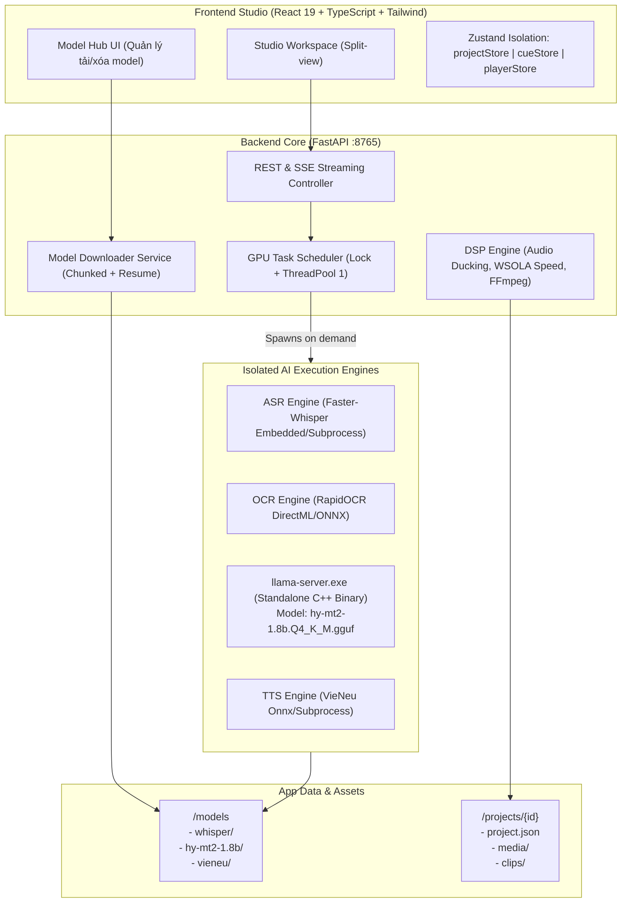
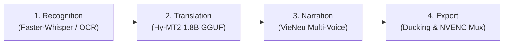
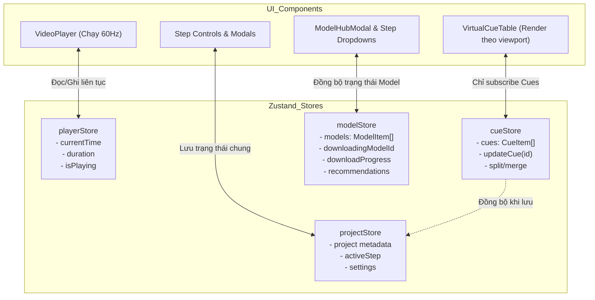

# 🎬 Video Dubbing AI Local — Hệ thống Lồng tiếng Video Đa ngữ (Product Architecture)

> **Tầm nhìn sản phẩm (Zero-Config Desktop Studio)**:  
> Hệ thống lồng tiếng video tự động và bán tự động (Trung → Việt, Anh → Việt) chuẩn đóng gói sản phẩm thương mại. Chạy hoàn toàn **Offline tại Local**, tối ưu sâu cho phần cứng phổ thông (từ CPU-only đến **NVIDIA GeForce GTX 1060 6GB VRAM** và các dòng GPU đời mới).
>
> 🎯 **Trải nghiệm người dùng cuối**: **Không gõ lệnh terminal, không cấu hình môi trường phức tạp**. Người dùng chỉ việc mở ứng dụng, chọn/tải Model mong muốn ngay trên giao diện (được gợi ý tối ưu theo cấu hình máy) và bấm chạy.

```
┌────────────────────────────────────────────────────────────────────────────────────────┐
│                        DUBBING-VIDEO ZERO-CONFIG ECOSYSTEM                             │
│                                                                                        │
│   [ Video Gốc ] ──► [ 1. ASR / OCR ] ──► [ 2. MT ] ──► [ 3. TTS ] ──► [ 4. Export ]   │
│                      Faster-Whisper        Hy-MT2        VieNeu         Ducking        │
│                       / RapidOCR           1.8B          Engine         FFmpeg         │
│                                              ▲                                         │
│                                     llama-server.exe                                   │
│                                     (Portable Sidecar)                                 │
│                                                                                        │
│   🎛️ IN-APP MODEL HUB: Quản lý & tải Model 1-click ngay trên UI Web / Desktop         │
│   ⚡ ZERO-LEAK VRAM: Tự động khởi động / tắt engine ngầm, thu hồi 100% VRAM             │
└────────────────────────────────────────────────────────────────────────────────────────┘
```

---

## Mục lục

1. [Đặc điểm nổi bật & Trải nghiệm Zero-Config](#1-đặc-điểm-nổi-bật--trải-nghiệm-zero-config)
2. [Kiến trúc giải pháp (Product Architecture)](#2-kiến-trúc-giải-pháp-product-architecture)
3. [Cơ chế In-App Model Hub (Tải & Gợi ý Model)](#3-cơ-chế-in-app-model-hub-tải--gợi-ý-model)
4. [Kiến trúc Module Dịch thuật: Hy-MT2 1.8B + llama-server.exe](#4-kiến-trúc-module-dịch-thuật-hy-mt2-18b--llama-serverexe)
5. [Cấu trúc thư mục dự án](#5-cấu-trúc-thư-mục-dự-án)
6. [Luồng Studio 4 bước (Human-in-the-loop)](#6-luồng-studio-4-bước-human-in-the-loop)
7. [Tech Stack](#7-tech-stack)
8. [Phân định phần cứng & Gợi ý cấu hình](#8-phân-định-phần-cứng--gợi-ý-cấu-hình)
9. [Cài đặt & Khởi chạy](#9-cài-đặt--khởi-chạy)
10. [Kiến trúc Frontend & Zustand State Management](#10-kiến-trúc-frontend--zustand-state-management)
11. [Kiến trúc Backend & Sidecar Runner](#11-kiến-trúc-backend--sidecar-runner)
12. [Hệ thống API Contract & Model Management API](#12-hệ-thống-api-contract--model-management-api)
13. [Chiến lược Kiểm thử (Testing Suite)](#13-chiến-lược-kiểm-thử-testing-suite)
14. [Đóng gói Desktop Ứng dụng (Tauri v2)](#14-đóng-gói-desktop-ứng-dụng-tauri-v2)
15. [Lộ trình phát triển sản phẩm (Roadmap)](#15-lộ-trình-phát-triển-sản-phẩm-roadmap)

---

## 1. Đặc điểm nổi bật & Trải nghiệm Zero-Config

* **1-Click Model Hub & Trải nghiệm Zero-Error trên UI**: Người dùng hoàn toàn thao tác trên giao diện, **không cần chạy bất kỳ file script hay file `.bat` nào**. Mọi model (Whisper, Hy-MT2, VieNeu) và binary thực thi (`llama-server.exe`) được tải trực tiếp từ UI với thanh tiến trình real-time.
* **Giao diện tự thích ứng theo trạng thái Model (Smart Morphing Action Buttons)**: Dropdown hiển thị rõ trạng thái `🟢 [Sẵn sàng]` hoặc `☁️ [Chưa tải]`. Nếu người dùng chọn một model chưa tải, nút bấm chính sẽ **tự động chuyển thành `[ ⬇️ Tải mô hình này ]` kèm % tiến độ trực tiếp**, loại bỏ 100% tình trạng bấm chạy bị báo lỗi thiếu model.
* **Cơ chế Hàng đợi Tải Đơn nhiệm (Single-Download Queue)**: Hệ thống khóa tải đồng thời ở cả Frontend (`modelStore`) và Backend (`CURRENT_DOWNLOADING_MODEL_ID`), chỉ cho phép tải từng model một nhằm đảm bảo băng thông tối đa và tránh xung đột file hay quá tải tài nguyên.
* **Tăng tốc độ tải 5–10x qua CDN Mirror (`hf-mirror.com`)**: Khắc phục triệt để tình trạng mạng chập chờn khi tải từ HuggingFace tại Việt Nam, nâng tốc độ tải model từ 1-2 MB/s lên tới 15–40 MB/s.
* **Tự động tải & quản lý Sidecar `llama-server.exe`**: Module dịch thuật tự động tải bộ binary portable `llama-server.exe` vào thư mục `bin/` khi tải model MT hoặc khi chạy dịch nếu chưa có. Backend tự khởi động khi dịch và tự hủy giải phóng 100% VRAM khi hoàn tất (Zero-Leak VRAM).
* **Chuyên biệt hóa Subtitle MT (Tencent Hunyuan Hy-MT2 1.8B)**: Sử dụng phiên bản chuẩn **Hy-MT2 1.8B Q4_K_M GGUF** (1.15 GB) tương thích hoàn hảo với CPU AVX2 và GPU CUDA, dịch 33 ngôn ngữ (Trung - Việt, Anh - Việt) đạt chất lượng vượt trội API thương mại.
* **Tối ưu hóa VRAM 6GB & Cơ chế Chống Deadlock Slot**: Kiến trúc **Single-Active Engine**: Tại một thời điểm, chỉ một engine AI nạp vào GPU. Bộ điều phối GPU slot tự động phát hiện và giải phóng tài nguyên phiên cũ khi chạy lại cùng một project, loại bỏ hoàn toàn lỗi kẹt slot `TASK_ALREADY_RUNNING`.
* **Giao diện 60 FPS mượt mà**: React 19 + `@tanstack/react-virtual` xử lý mượt mà hàng nghìn câu thoại không giật lag.
* **Hòa âm tự động (DSP Ducking)**: Tự động hạ nhạc nền (Attack 150ms / Release 400ms) và căn chỉnh tốc độ đọc tự nhiên với thuật toán mượn khoảng lặng (**Silence Gap Borrowing**).

---

## 2. Kiến trúc giải pháp (Product Architecture)

Hệ thống được thiết kế theo mô hình **Embedded Micro-Engine & Sidecar Pattern**:



---

## 3. Cơ chế In-App Model Hub (Tải & Gợi ý Model)

Người dùng không chuyên không cần biết mô hình AI lưu ở đâu, cũng như **không cần mở terminal hay chạy bất kỳ file `.bat` nào**. Mọi thao tác tải và quản lý đều diễn ra ngay trên giao diện:

1. **Auto-Detect Phần cứng**: Hệ thống kiểm tra dung lượng RAM, GPU và VRAM hiện có.
2. **Gợi ý thông minh (Hardware Recommendation Tag)**:
   - Gắn nhãn `[Khuyên dùng cho máy bạn]`, `[Nhẹ - CPU]`, hoặc `[Chất lượng cao - Cần GPU mạnh]`.
3. **Cơ chế tải đơn nhiệm (Single-Download Queue)**:
   - Nhằm tối đa hóa băng thông và tránh xung đột ghi đĩa hoặc cạn kiệt tài nguyên máy, hệ thống chỉ cho phép tải **từng model một**.
   - Khi một model đang tải, tất cả các nút tải model khác trong Hub hoặc ngoài các bước wizard sẽ hiển thị trạng thái `Đang tải model khác...` và bị vô hiệu hóa.
4. **Tăng tốc độ tải bằng CDN Mirror (`hf-mirror.com`)**:
   - Tất cả đường dẫn tải từ HuggingFace được định tuyến tự động qua mirror proxy CDN tốc độ cao, giúp tăng tốc độ tải từ 1–2 MB/s lên **15–40 MB/s** tại Việt Nam.
5. **Tự động tải Binary phụ trợ (`llama-server.exe`)**:
   - Khi người dùng tải model dịch thuật Hy-MT2 (hoặc khi bắt đầu Bước 2), nếu thư mục `bin/` chưa có `llama-server.exe`, hệ thống sẽ tự động tải bản portable tương thích và giải nén trong vài giây mà không cần người dùng thao tác gì thêm.
6. **Smart Dropdowns & Morphing Action Buttons (Trải nghiệm Zero-Error)**:
   - Các dropdown chọn model tại Bước 1 (Nhận diện), Bước 2 (Dịch thuật), Bước 3 (Lồng tiếng) hiển thị rõ icon:
     - `🟢 [Sẵn sàng]`: Model đã có trong máy, sẵn sàng bấm chạy.
     - `☁️ [Chưa tải]`: Model chưa tải về.
   - Nếu người dùng chọn model `☁️ [Chưa tải]`, nút bấm chính của bước sẽ **tự động biến đổi (morph)** thành nút `[ ⬇️ Tải mô hình này ]` kèm phần trăm tiến độ tải real-time. Người dùng bấm tải trực tiếp tại đó, tải xong nút tự chuyển về trạng thái thực thi. Hoàn toàn không phát sinh lỗi bấm nhầm khi chưa có model!

---

## 4. Kiến trúc Module Dịch thuật: Hy-MT2 1.8B + llama-server.exe

Loại bỏ hoàn toàn kiến trúc nạp Python Transformers nặng nề hoặc yêu cầu người dùng cài đặt LM Studio hay Python môi trường bên ngoài.

### Nguyên lý hoạt động
1. **Engine**: Bộ thực thi nhúng `llama-server.exe` (biên dịch tĩnh từ llama.cpp với hỗ trợ CUDA và CPU AVX2, dung lượng ~25 MB). Hệ thống tự kiểm tra và tải về tự động qua hàm `ensure_llama_server()`.
2. **Model**: **`Hy-MT2-1.8B-Q4_K_M.gguf`** (~1.15 GB) — phiên bản lượng tử hóa tiêu chuẩn, ổn định tuyệt đối trên cả CPU và GPU. *(Lưu ý: Đã loại bỏ bản 1.25-bit thử nghiệm do cấu trúc tensor non-standard AngelSlim gây lỗi offset trên llama.cpp chuẩn)*.
3. **Quy trình kích hoạt ngầm**:
   ```
   [Bắt đầu Bước 2 (Dịch thuật)]
          │
          ▼
   Kiểm tra bin/llama-server.exe (Nếu thiếu -> Tự động tải về bin/)
          │
          ▼
   Backend tự khởi chạy tiến trình con:
   bin/llama-server.exe -m models/mt/hy-mt2-1.8b-q4/Hy-MT2-1.8B-Q4_K_M.gguf -c 4096 --port 12345 -ngl 99
          │
          ▼
   Backend gửi REST API dịch các Scene Batch qua http://127.0.0.1:12345/v1/chat/completions
          │
          ▼
   [Dịch hoàn tất] ──► Backend kill process llama-server.exe ──► Thu hồi 100% VRAM lập tức!
   ```

---

## 5. Cấu trúc thư mục dự án

```text
dubbing-video/
├── docs/
│   ├── CORE_NOTES.md                 # Thuật toán chi tiết: Borrow Gap, Ducking, Timing
│   └── API_CONTRACT.md               # Đặc tả 16+ REST/SSE API và schemas
│
├── bin/                              # 📦 Binary thực thi Portable (không cần cài đặt)
│   ├── llama-server.exe              # Standalone LLM Server (C++ / CUDA)
│   ├── ffmpeg.exe                    # Portable FFmpeg engine
│   └── ffprobe.exe                   # Trích xuất metadata media
│
├── models/                           # 🧠 Thư mục lưu Model weights (In-App Hub tải vào đây)
│   ├── asr/                          # faster-whisper (tiny, small, medium)
│   ├── mt/                           # hy-mt2-1.8b GGUF variants
│   └── tts/                          # VieNeu v3 checkpoints & ONNX
│
├── modules/                          # 🧩 Các adapter thực thi logic AI độc lập
│   ├── asr/                          # Faster-Whisper VAD & timestamp slicing
│   ├── ocr/                          # RapidOCR subtitle text extractor
│   ├── mt/                           # Client điều phối ngữ cảnh, prompt & batching cho Hy-MT2
│   └── tts/                          # VieNeu TTS speech synthesis & time-stretching
│
├── backend/                          # 🚀 FastAPI Backend Coordinator
│   ├── server.py                     # Entry point server (Port 8765)
│   ├── schemas.py                    # Pydantic v2 schemas & contract
│   ├── model_manager.py              # Sidecar Runner & GPU Queue controller
│   ├── model_hub.py                  # Dịch vụ tải, kiểm tra và quản lý model tự động
│   ├── audio_mixer.py                # DSP NumPy Audio Ducking, WSOLA & Muxing
│   ├── test_backend.py               # Test suite tự động
│   └── requirements.txt              # Backend core dependencies
│
├── frontend/                         # 💻 Studio UI (React 19 + TypeScript + Vite)
│   ├── src/
│   │   ├── components/
│   │   │   ├── Header.tsx            # Header, Quản lý Project & Hardware Status
│   │   │   ├── ModelHubModal.tsx     # 🎛️ Modal tải & kích hoạt Model 1-Click
│   │   │   ├── VideoPlayer.tsx       # HTML5 Native Player + Range Seek + Subtitle Overlay
│   │   │   ├── StepWizard.tsx        # Wizard thanh điều hướng 4 bước
│   │   │   ├── steps/                # Màn hình chuyên biệt cho 4 bước
│   │   │   └── virtual/              # VirtualCueTable (@tanstack/react-virtual)
│   │   ├── stores/                   # Zustand stores (projectStore, cueStore, playerStore)
│   │   ├── hooks/                    # useSSE, useModelHub
│   │   └── types/                    # TypeScript Data Contracts
│   ├── package.json
│   └── vite.config.ts
│
├── projects/                         # 📁 Runtime project storage
│   └── prj_{timestamp}/              # Dữ liệu dự án độc lập
│
└── README.md
```

---

## 6. Luồng Studio 4 bước (Human-in-the-loop)



1. **Bước 1 — Nhận diện (Recognition)**: Tách thoại video bằng Faster-Whisper (tích hợp Silero VAD) hoặc trích xuất phụ đề cứng bằng RapidOCR. Người dùng xem trước, sửa lỗi từ nhận diện, tách/gộp câu và gắn vai người nói (Speaker ID).
2. **Bước 2 — Dịch thuật (Translation)**: `llama-server.exe` tự động kích hoạt ngầm chạy `hy-mt2-1.8b`. Dịch theo cụm phân cảnh (Scene Batching) bảo toàn đại từ nhân xưng, tái cấu trúc câu hoàn chỉnh và đối soát glossary. Người dùng có thể dịch lại câu đơn lẻ với các văn phong tùy chỉnh.
3. **Bước 3 — Lồng tiếng (Narration)**: Áp dụng thuật toán mượn khoảng lặng (**Silence Gap Borrowing**) và tính toán tốc độ phát tự động ($R_{speed} = \operatorname{clamp}(R_{raw}, 1.0, 2.0)$). Tùy biến gán 18 giọng bản địa VieNeu (Bắc - Trung - Nam) cho từng nhân vật và nghe thử tức thì.
4. **Bước 4 — Xuất video (Export)**: Tự động hạ âm lượng nhạc nền video gốc qua bộ lọc **DSP Audio Ducking** (Attack 150ms / Release 400ms) mượt mà, hòa trộn giọng lồng tiếng, chèn phụ đề mềm/cứng và render file video thành phẩm cực nhanh bằng GPU NVENC.

---

## 7. Tech Stack

| Thành phần | Công nghệ chính | Vai trò kỹ thuật |
|:---|:---|:---|
| **Frontend** | React 19, TypeScript, Vite, Tailwind CSS | Giao diện Studio siêu nhẹ, phản hồi tức thì |
| **Virtualization** | `@tanstack/react-virtual` | Ảo hóa danh sách câu thoại duy trì 60 FPS |
| **State Management**| Zustand v5 (Isolated 4-Store pattern) | Tách biệt playerStore (60Hz), cueStore, projectStore và modelStore |
| **Backend Core** | FastAPI, Uvicorn, Pydantic v2, Aiofiles | Server điều phối REST, SSE Streaming & HTTP 206 |
| **LLM Sidecar** | `llama-server.exe` (llama.cpp) | Engine portable chạy GGUF không cần cài đặt (Auto-provisioning) |
| **MT Model** | Tencent Hunyuan Hy-MT2 1.8B (Q4_K_M) | Dịch máy ngữ cảnh đa ngữ tối ưu phụ đề |
| **TTS Engine** | VieNeu v3.8+ (Kaldi, Sea-G2P, Soxr, SciPy) | Tổng hợp giọng đọc tiếng Việt đa phương ngữ chất lượng cao |
| **Audio DSP** | NumPy, SoundFile, SciPy | Hòa âm Ducking, Time-stretching, Audio Processing |
| **Media Toolkit** | FFmpeg & FFprobe (Portable) | Giải mã, trích xuất audio và ghép video phần cứng |

---

## 8. Phân định phần cứng & Gợi ý cấu hình

Hệ thống tự động nhận diện cấu hình máy của người dùng và hiển thị đề xuất trong Model Hub:

| Phân khúc phần cứng | Cấu hình máy | Gợi ý ASR Model | Gợi ý MT Model (Hy-MT2) | Gợi ý TTS Model | Khả năng đáp ứng |
|:---|:---|:---|:---|:---|:---|
| **Entry / CPU-only** | CPU Core i5/Ryzen 5, 8–16GB RAM | Whisper Tiny / Base | Hy-MT2 1.8B (Q4_K_M - 1.15GB) | VieNeu CPU Int8 | Hoạt động tốt, thời gian xử lý chậm hơn |
| **Phổ thông (Mục tiêu)** ⭐ | GTX 1060 / RTX 2060 (6GB VRAM) | **Whisper Small (Int8)** | **Hy-MT2 1.8B (Q4_K_M - 1.15GB)** | **VieNeu v3 Onnx** | **Mượt mà, cân bằng hoàn hảo giữa tốc độ và độ chính xác** |
| **Trung & Cao cấp** | RTX 3060 / 4060 trở lên (8–16GB VRAM)| Whisper Medium / Large | Hy-MT2 1.8B (Q8 / FP16) | VieNeu v3 High Quality | Tốc độ siêu nhanh, bản dịch và âm thanh xuất sắc |

---

## 9. Cài đặt & Khởi chạy

> 💡 **Dành cho người dùng cuối**: Sau khi khởi động Backend và Frontend, **100% các model AI và binary thực thi (`llama-server.exe`) được tải trực tiếp từ giao diện Model Hub**. Bạn không cần tải thủ công bất kỳ file weights nào, không cần cài LM Studio hay chạy bất kỳ file `.bat` phức tạp nào.

### Dành cho nhà phát triển (Development Setup)

#### 1. Khởi chạy Backend
```powershell
cd dubbing-video/backend
python -m venv .venv
.\.venv\Scripts\activate
pip install -r requirements.txt
python -m uvicorn server:app --host 127.0.0.1 --port 8765 --reload
```

#### 2. Khởi chạy Frontend
```powershell
cd dubbing-video/frontend
npm install
npm run dev
```

Truy cập Studio tại: `http://localhost:5173`

---

## 10. Kiến trúc Frontend & Zustand State Management

Để xử lý video mượt mà và không gây đơ lag giao diện khi đang chỉnh sửa hàng trăm câu phụ đề, Frontend áp dụng quy tắc **Phân tách Store nghiêm ngặt (Isolated State Architecture)** qua 4 Zustand Stores độc lập:



* **`playerStore`**: Quản lý `currentTime` (cập nhật 60 lần/giây theo khung hình video). Chỉ `VideoPlayer` và thanh Seekbar lắng nghe store này. Bảng danh sách câu **tuyệt đối không subscribe** `playerStore` để tránh re-render toàn bộ bảng.
* **`cueStore`**: Chứa danh sách câu thoại (`cues`), hỗ trợ cập nhật cục bộ theo ID, tách câu, gộp câu.
* **`projectStore`**: Quản lý thông tin dự án, cấu hình thuật toán và kết nối API.
* **`modelStore`**: Quản trị tập trung toàn bộ trạng thái model:
  - Tự động quét và đồng bộ trạng thái `🟢 [Sẵn sàng]` / `☁️ [Chưa tải]` ngay khi mở app.
  - Quản lý hàng đợi tải đơn nhiệm (`downloadingModelId`), ngăn chặn tải đồng thời nhiều model.
  - Lắng nghe sự kiện SSE tiến độ tải (`downloadProgress`) và cập nhật đồng thời lên cả Modal Hub lẫn các nút bấm thích ứng (Morphing Action Buttons) tại từng bước.
* **Cơ chế Hook `useSSE` an toàn**: Bắt lỗi trực tiếp từ luồng sự kiện SSE, cập nhật cờ `error` và gọi callback ngay lập tức mà không nuốt ngoại lệ (fix silent error swallow).

---

## 11. Kiến trúc Backend & Sidecar Runner

FastAPI đóng vai trò nhạc trưởng điều phối các Engine:

1. **GPU Task Scheduler & Cơ chế Tự giải phóng Slot (Deadlock Prevention)**:
   - Sử dụng `ThreadPoolExecutor(max_workers=1)` ngăn chặn 2 model AI cùng lúc tranh chấp VRAM gây lỗi CUDA Out-Of-Memory.
   - Hàm `acquire_slot()` được trang bị cơ chế tự giải phóng slot cũ: Nếu nhận được yêu cầu mới từ cùng một dự án (ví dụ khi người dùng thử lại hoặc chạy tiếp), server sẽ tự động thu hồi tài nguyên của phiên trước, loại bỏ hoàn toàn lỗi kẹt `TASK_ALREADY_RUNNING`.
2. **Lifecycle Sidecar Manager & Tự động Cung ứng (`ensure_llama_server`)**:
   - Khi chuyển sang Step 2, Backend tự động kiểm tra `bin/llama-server.exe`. Nếu chưa có, hệ thống tự động tải và giải nén bản portable tương thích.
   - Khởi tạo tiến trình con `llama-server.exe` chạy model `Hy-MT2-1.8B-Q4_K_M.gguf`. Khi dịch xong, tiến trình bị kết thúc và hệ điều hành thu hồi 100% VRAM ngay lập tức.
3. **Cơ chế Khóa Tải Đơn nhiệm (`CURRENT_DOWNLOADING_MODEL_ID`)**:
   - Ngăn chặn việc tải nhiều file model dung lượng lớn song song, bảo toàn băng thông đường truyền và tránh xung đột I/O ghi đĩa.
4. **HTTP 206 Media Streaming**:
   - Endpoint `/api/media/stream` hỗ trợ Range Requests để người dùng tua video nhanh mà không cần nạp toàn bộ file vào RAM.

---

## 12. Hệ thống API Contract & Model Management API

Bên cạnh 12 endpoint nghiệp vụ lồng tiếng, hệ thống bổ sung nhóm API quản lý Model tự động:

### Nhóm Model Hub API
* `GET /api/models/status`: Kiểm tra danh sách model đã tải và trạng thái sẵn sàng.
* `GET /api/models/recommendations`: Nhận gợi ý model tối ưu dựa trên GPU và RAM quét được từ máy.
* `POST /api/models/download`: Kích hoạt luồng tải model ngầm (SSE stream % tiến độ tải).
* `DELETE /api/models/{modelId}`: Xóa file model giải phóng ổ cứng.

### Nhóm Pipeline 4 bước (REST & SSE)
* `POST /api/step1/recognize`: Chạy ASR/OCR qua SSE progress stream.
* `POST /api/step1/update-cues`: Cập nhật chỉnh sửa cues từ UI.
* `POST /api/step2/translate`: Khởi chạy `llama-server.exe` và dịch qua Hy-MT2.
* `POST /api/step2/translate-single`: Dịch lại 1 câu cue với văn phong tùy chọn.
* `GET /api/tts/voices`: Lấy danh sách 18 giọng đọc VieNeu.
* `POST /api/step3/synthesize`: Tổng hợp âm thanh hàng loạt qua SSE.
* `POST /api/step4/export`: Trộn âm ducking và xuất video hoàn thiện.

---

## 13. Chiến lược Kiểm thử (Testing Suite)

Hệ thống duy trì bộ kiểm thử tự động toàn diện:

### 1. Backend Verification
```powershell
cd backend
python test_backend.py
```
Kiểm tra tính đúng đắn của:
* Thuật toán nhận diện vế câu dở dang (`is_incomplete_sentence`).
* Thuật toán mượn khoảng lặng (`expand_cues_into_silence_gaps`).
* Giới hạn tỷ lệ co giãn tốc độ (`calculate_playback_rate`).
* Hàm tính toán âm lượng Audio Ducking Envelope (Attack/Release).
* Quản lý trạng thái và lưu trữ `project.json`.

### 2. Frontend Verification
```powershell
cd frontend
npx tsc --noEmit     # Đảm bảo 100% Type-safe
npm run lint         # Kiểm tra chuẩn phong cách mã nguồn
npm run build        # Xác thực đóng gói Bundle Production
```

---

## 14. Đóng gói Desktop Ứng dụng (Tauri v2)

Đóng gói thành phần mềm Desktop Windows hoàn chỉnh:
```
dubbing-video.exe (Tauri App Shell)
├── Web Frontend UI (Giao diện React nhúng trong WebView2 siêu nhẹ)
├── Backend Sidecar (FastAPI đóng gói standalone qua PyInstaller)
└── Embedded Binaries (llama-server.exe, ffmpeg.exe trong bin/)
```

Lệnh đóng gói:
```powershell
cd frontend
npm install -D @tauri-apps/cli@next
npx tauri build
```

---

## 15. Lộ trình phát triển sản phẩm (Roadmap)

### Giai đoạn 1: Chuẩn hóa Kiến trúc & Model Hub (Hoàn thành)
- [x] Thiết kế kiến trúc Zero-Config & loại bỏ phụ thuộc LM Studio.
- [x] Chuyển đổi toàn diện sang Tencent Hunyuan Hy-MT2 1.8B Q4_K_M GGUF.
- [x] Xây dựng In-App Model Hub với Zustand `modelStore` tập trung.
- [x] Tích hợp `bin/llama-server.exe` sidecar manager và cơ chế auto-provisioning.
- [x] Giao diện thích ứng Zero-Error (Smart Dropdowns `🟢 Sẵn sàng` / `☁️ Chưa tải` & Morphing Action Buttons).
- [x] Cơ chế Hàng đợi Tải Đơn nhiệm (Single-Download Queue) bảo toàn băng thông mạng và I/O đĩa.
- [x] Tăng tốc độ tải 5–10x qua CDN Mirror (`hf-mirror.com`).
- [x] Cơ chế chống Deadlock GPU slot (`TASK_ALREADY_RUNNING`) & Sửa lỗi nuốt ngoại lệ SSE (`useSSE.ts`).

### Giai đoạn 2: Nâng cấp Trải nghiệm Studio
- [ ] Dashboard quản lý danh sách nhiều project (tạo mới, mở lại, xóa).
- [ ] Tính năng tự động lưu (Auto-save) sau mỗi thao tác chỉnh sửa câu.
- [ ] Thanh timeline hiển thị trực quan dạng sóng âm thanh (Audio Waveform).

### Giai đoạn 3: Tối ưu hóa Nâng cao & Phân phối
- [ ] Hỗ trợ đa ngôn ngữ giao diện (i18n: Tiếng Việt, Tiếng Anh).
- [ ] Đóng gói bộ cài đặt One-Click Desktop Windows (`.msi` / `.exe`).
- [ ] Tối ưu hóa bộ nhớ đệm (Cache) cho các câu đã từng dịch và thuyết minh.

---

<div align="center">
  <sub>Phát triển phục vụ Đề tài Nghiên cứu Khoa học — Kiến trúc Hệ thống Lồng tiếng Video AI Local Chuyên nghiệp</sub>
</div>
