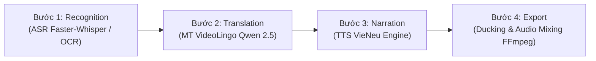

# CORE NOTES: KIẾN TRÚC & THUẬT TOÁN HỆ THỐNG VIDEO DUBBING AI LOCAL

> **Dự án**: Nghiên cứu Khoa học - Hệ thống Lồng tiếng Video Đa ngữ (Video Dubbing) Tự động Hóa  
> **Kiến trúc**: Bridge Runner Pattern (Module AI CLI độc lập ➔ FastAPI Backend Server ➔ Web Studio UI)  
> **Phần cứng mục tiêu**: NVIDIA GeForce GTX 1060 6GB VRAM, CPU đa nhân, 16GB RAM, Windows OS.

---

## 1. LUỒNG STUDIO 4 BƯỚC (THE 4-STEP STUDIO WORKFLOW)

Quy trình xử lý một video lồng tiếng trải qua 4 bước tuần tự, mỗi bước có thể can thiệp thủ công (Human-in-the-loop) trước khi chuyển tiếp sang bước tiếp theo:



### Bước 1: Nhận dạng Lời thoại / Phụ đề (Recognition)
- **Nguồn đầu vào**: Video gốc (`.mp4`, `.mkv`, `.mov`) hoặc tệp âm thanh tách rời.
- **Phương thức thực thi**:
  - **Chế độ ASR (Chính)**: Faster-Whisper trích xuất lời thoại nguyên bản, tách mốc thời gian chính xác theo từng từ (word-level timestamps), loại bỏ ảo giác và tiếng thở qua Silero VAD (ngưỡng 0.45, đệm 200ms), chia câu thông minh theo khoảng lặng >= 0.4s và thời lượng <= 5.0s (chuẩn CapCut).
  - **Chế độ OCR (Phụ - Subtitle Hardsub)**: TextMaskExtractor lọc chữ khỏi nền chuyển động, kết hợp RapidOCR (PP-OCRv6 DirectML) trích xuất phụ đề cứng trên khung hình.
- **Dữ liệu đầu ra**: Danh sách Cues nguyên bản kèm timestamp (`start`, `end`, `duration`), độ tin cậy (`confidence`), phân vai người nói (`speaker_id`).
- **Tương tác Studio**: Người dùng duyệt, sửa đổi từ ngữ nhận diện sai, gộp/tách câu, gán vai người nói (Speaker Roles).

### Bước 2: Dịch thuật Đa ngữ Ngữ cảnh (Translation)
- **Phương thức thực thi**: Module MT Qwen 2.5 1.5B Instruct (CTranslate2 INT8).
- **Thuật toán cốt lõi**:
  - *Pass-1 Global Context*: Quét toàn bộ kịch bản để phân tích thể loại (genre), bối cảnh cốt truyện (synopsis), sắc thái xưng hô (persona: neutral/informal/polite/intimate) và đối soát thực thể trong từ điển (`glossary.json`).
  - *Sentence Reconstruction*: Tự động nối các cues vụn bị ngắt giữa chừng thành câu hoàn chỉnh ngữ pháp trước khi dịch.
  - *Scene-Aware Sliding Batch*: Dịch theo từng cụm phân cảnh (6-10 câu), kèm lịch sử 3 câu trước để bảo toàn mạch đại từ nhân xưng.
  - *Proportional Re-splitting & TTS Guard*: Tách bản dịch trả về đúng số lượng và timecode của từng cue gốc, đồng thời kiểm soát độ dài âm tiết phù hợp với tốc độ đọc tự nhiên tiếng Việt (~3.4 từ/giây).
- **Tương tác Studio**: Người dùng có thể chỉnh sửa văn bản tiếng Việt, dịch lại từng câu đơn lẻ (`translate-single`), áp dụng thuật ngữ riêng.

### Bước 3: Tổng hợp Giọng đọc Thuyết minh (Narration)
- **Phương thức thực thi**: Module TTS VieNeu (v3-Turbo cục bộ hoặc Cloud API).
- **Thuật toán căn chỉnh thời lượng**:
  - Thuật toán `borrow_gap`: Mượn khoảng lặng giữa các câu để nới rộng thời gian đọc cho câu thoại dài.
  - Tự động co giãn tốc độ `speed_factor` (1.0x - 2.0x, cảnh báo xem lại nếu > 1.5x) mà không làm méo ngữ điệu giọng.
  - Duy trì liền mạch giữa các vế câu chưa dứt (`isIncompleteSentence`) với khoảng đệm lấy hơi ngắn 0.08s.
- **Dữ liệu đầu ra**: Các tệp âm thanh WAV đơn lẻ cho từng cue (`cue_0001.wav`, `cue_0002.wav`...) được lưu trong thư mục `clips/`.
- **Tương tác Studio**: Người dùng có thể nghe thử, đổi giọng đọc (Voice Picker), đổi tốc độ, sinh lại audio cho từng câu (`synthesize-single`).

### Bước 4: Trộn âm & Xuất bản Video (Export)
- **Phương thức thực thi**: FFmpeg xử lý đa luồng audio và video.
- **Xử lý âm thanh đa kênh**:
  - Nhạc nền (BGM / SFX): Áp dụng **Audio Ducking** tự động — hạ âm lượng nhạc nền xuống 15% (-16.5 dB) ngay khi có giọng thuyết minh cất lên, với độ dốc Attack 150ms và Release 400ms.
  - Tách giọng gốc (Vocal Remover nếu có) hoặc hạ nhỏ âm thanh thoại gốc (`sourceVolumeDb`).
  - Trộn giọng thuyết minh TTS đã căn chuẩn timecode vào dòng thời gian.
  - Render video đầu ra với phụ đề mềm (Softsub ASS/SRT) hoặc phụ đề ghi đè (Hardsub).

---

## 2. CÔNG THỨC TOÁN HỌC & THUẬT TOÁN CỐT LÕI

### 2.1. Công thức Tính toán Tốc độ Phát (`speed_factor`)

Mục tiêu: Đảm bảo độ dài tệp âm thanh TTS vừa vặn với thời lượng hiển thị cue trên timeline mà không làm biến dạng giọng nói quá mức.

Gọi:
- $T_{\text{raw}}$: Thời lượng thực tế của clip TTS sinh ra (giây), $T_{\text{raw}} \ge 0.01$.
- $T_{\text{target}}$: Thời lượng mục tiêu của cue (sau khi đã tính cả khoảng lặng mượn được $T_{\text{available}}$), $T_{\text{target}} \ge 0.1$.
- $R_{\text{speed}}$: Hệ số tốc độ phát (`playbackRate` hay `speed_factor`).

Thuật toán định thời (`planNarrationTiming`):

$$R_{\text{raw}} = \frac{T_{\text{raw}}}{T_{\text{target}}}$$

1. **Nếu không bật khớp thời lượng (`autoMatchDuration = false`)**:
   $$R_{\text{speed}} = 1.0, \quad T_{\text{final}} = T_{\text{raw}}, \quad \Delta = T_{\text{final}} - T_{\text{target}}$$
   Cờ `needsReview = true` khi $|\Delta| > 0.08\text{s}$.

2. **Nếu $T_{\text{raw}} \le T_{\text{target}}$ (Thoại ngắn hơn khung giờ cue)**:
   Không ép chậm (tránh kéo lê giọng vô lý):
   $$R_{\text{speed}} = 1.0, \quad T_{\text{final}} = T_{\text{raw}}, \quad \Delta = 0, \quad \text{needsReview} = \text{false}$$

3. **Nếu $T_{\text{raw}} > T_{\text{target}}$ (Thoại dài hơn khung giờ cue)**:
   Tăng tốc đọc linh hoạt (đã bỏ trần 1.35x, cho phép co dãn lên đến 2.0x cho các câu ngắn tiếng Việt):
   $$R_{\text{speed}} = \operatorname{clamp}(R_{\text{raw}}, 1.0, 2.0) = \min(2.0, \max(1.0, R_{\text{raw}}))$$
   $$T_{\text{final}} = \frac{T_{\text{raw}}}{R_{\text{speed}}}$$
   Cờ cảnh báo `needsReview = true` khi $R_{\text{raw}} > 2.0$ (câu quá dài chạm trần tốc độ tối đa).

---

### 2.2. Thuật toán Mượn Khoảng Lặng Hai Chiều (`borrow_gap`)

Thuật toán giải quyết vấn đề: Tiếng Việt sau khi dịch từ tiếng Trung/Anh thường có số lượng âm tiết dài hơn 20% - 40%, dẫn đến thiếu hụt thời gian đọc. Thuật toán tận dụng các khoảng lặng chết giữa các câu thoại để nới dài thời lượng mà không làm chồng lấn (overlap) sang câu kế tiếp.

#### Các tham số cấu hình (`GapExpansionOptions`):
- $WPS = 3.4$ (Tốc độ đọc tiếng Việt mục tiêu: 3.4 từ/giây).
- $P_{\text{safety}} = 0.25\text{s}$ (Đệm an toàn tối thiểu giữa 2 câu độc lập).
- $G_{\text{clause\_max}} = 0.35\text{s}$ (Khoảng cách tối đa giữa 2 vế trong cùng 1 câu chưa dứt).
- $k_{\text{ratio}} = 0.85$ (Tỷ lệ khoảng lặng tối đa được phép mượn: 85%).
- $T_{\text{borrow\_max}} = 3.5\text{s}$ (Thời gian nới thêm tối đa cho một câu).

#### Nhận diện vế câu liên tục (`isIncompleteSentence(A, B)`):
Trả về `true` nếu câu A và B là cùng một luồng diễn đạt chưa kết thúc:
1. Nếu A kết thúc bằng dấu chấm kết thúc (`.`, `!`, `?`, `。`, `！`, `？`, `…`) $\rightarrow$ `false` (đã hết câu).
2. Nếu A kết thúc bằng dấu phẩy, hai chấm, chấm phẩy, gạch nối (`,`, `:`, `;`, `-`, `~`, `，`, `、`) $\rightarrow$ `true`.
3. Nếu A kết thúc bằng từ nối tiếng Việt: *và, mà, hoặc, nhưng, bởi, vì, đối với, trong khi, là, của, rằng, thì, ở, với, đã, đang, sẽ, có, để, cho, hay, nên, nếu, khi, như, về, từ, bằng, theo, do, tại, cùng, cũng, rồi, lại, vừa, chưa, không, chẳng, rất, quá, lắm, thế, vậy, này, kia, đó, đây, được, bị, phải, muốn, cần, thấy, nghe, nói, biết, nghĩ...* $\rightarrow$ `true`.
4. Nếu ký tự đầu tiên của B là chữ thường (không viết hoa) $\rightarrow$ `true`.
5. Nếu B bắt đầu bằng liên từ nối: *mà, và, nhưng, hoặc, cho nên, vì vậy, bởi vì, đối với, trong đó, mà còn, cũng như, thì, lại, với...* $\rightarrow$ `true`.

#### Tiến trình mở rộng 3 bước:
- **Bước 1: Forward Expansion & Clause Continuity**:
  - Với câu $i$ có điểm kết thúc $E_i$ và câu $i+1$ có điểm bắt đầu $S_{i+1}$:
  - Khoảng trống gốc: $\text{rawGap} = \max(0, S_{i+1} - E_i)$.
  - Ước lượng thời gian cần: $T_{\text{needed}} = \max\left(0.6, \frac{\text{wordCount}(T_i)}{WPS}\right)$.
  - **Trường hợp A (Vế câu tiếp diễn - `isContinuation = true`)**:
    Kéo $E_i$ sát tới $S_{i+1}$:
    $$E_i^{\text{new}} = \min(S_{i+1} - 0.15, \max(E_i, S_{i+1} - G_{\text{clause\_max}}))$$
  - **Trường hợp B (Câu độc lập riêng biệt)**:
    $$\text{availableGap} = \max(0, \text{rawGap} - P_{\text{safety}})$$
    $$\text{borrowableGap} = \min(T_{\text{borrow\_max}}, \text{availableGap} \times k_{\text{ratio}})$$
    $$\Delta_{\text{extra}} = \min(\max(0, T_{\text{needed}} - \text{dur}_i), \text{borrowableGap})$$
    $$E_i^{\text{new}} = E_i + \Delta_{\text{extra}}$$

- **Bước 2: Backward Expansion (Nới nhẹ về phía trước)**:
  - Nếu câu $i$ vẫn thiếu thời lượng và khoảng trống phía trước $S_i - E_{i-1} > 0.5\text{s}$:
    $$\Delta_{\text{shift}} = \min(0.6\text{s}, \min(T_{\text{needed}} - \text{dur}_i, S_i - E_{i-1} - P_{\text{safety}}))$$
    $$S_i^{\text{new}} = S_i - \Delta_{\text{shift}}$$

- **Bước 3: Khử chồng lấn tuyệt đối (Monotonic Timestamps Guard)**:
  - Duyệt toàn bộ mảng: nếu $S_i < E_{i-1}$, tự động căn chỉnh:
    $$S_i = E_{i-1} \quad \text{(nếu } E_i > E_{i-1} + 0.15\text{)} \quad \text{hoặc} \quad S_i = E_{i-1} = \frac{E_{i-1} + S_i}{2}$$

---

### 2.3. Logic Audio Ducking & Mixing

Audio Ducking đảm bảo người xem nghe rõ lời thuyết minh tiếng Việt mà không phải tắt hoàn toàn âm nhạc và hiệu ứng âm thanh của video gốc.

#### Các tham số Envelope:
- $V_{\text{base}}$: Âm lượng gốc của nhạc nền (thường = 1.0).
- $V_{\text{duck}}$: Hệ số âm lượng khi bị hạ (mặc định $0.15$, tức giảm ~ -16.5 dB).
- $T_{\text{attack}} = 150\text{ms} = 0.15\text{s}$ (Thời gian chuyển tiếp vuốt nhỏ dần).
- $T_{\text{release}} = 400\text{ms} = 0.40\text{s}$ (Thời gian phục hồi âm lượng ban đầu sau khi dứt lời).

#### Hợp nhất các cửa sổ Ducking (`mergeDuckWindows`):
Mỗi clip âm thanh thuyết minh tại track narration tạo ra một cửa sổ $[S_k, E_k]$.
Nếu $S_{k+1} \le E_k$, hợp nhất hai cửa sổ:
$$E_k = \max(E_k, E_{k+1})$$

#### Hàm tính toán Gain tại thời điểm $t$ (`gainAtTime`):
Cho thời điểm $t$ trên timeline và cửa sổ ducking $[S, E]$:
1. **Trước cửa sổ ($t < S$) hoặc sau khi xả ($t > E + T_{\text{release}}$)**:
   $$\operatorname{Gain}(t) = V_{\text{base}}$$
2. **Giai đoạn Attack ($S \le t < S + T_{\text{attack}}$)**:
   Nội suy tuyến tính (Linear Lerp) hạ dần:
   $$\operatorname{Gain}(t) = \operatorname{lerp}\left(V_{\text{base}}, V_{\text{duck}} \times V_{\text{base}}, \frac{t - S}{T_{\text{attack}}}\right)$$
3. **Giai đoạn Giữ âm lượng thấp ($S + T_{\text{attack}} \le t \le E$)**:
   $$\operatorname{Gain}(t) = V_{\text{duck}} \times V_{\text{base}}$$
4. **Giai đoạn Release ($E < t \le E + T_{\text{release}}$)**:
   Nội suy tuyến tính tăng dần trả về bình thường:
   $$\operatorname{Gain}(t) = \operatorname{lerp}\left(V_{\text{duck}} \times V_{\text{base}}, V_{\text{base}}, \frac{t - E}{T_{\text{release}}}\right)$$

Trong đó:
$$\operatorname{lerp}(a, b, p) = a + (b - a) \times \operatorname{clamp}(p, 0, 1)$$

#### Quy đổi Đề-xi-ben sang Hệ số Tuyến tính:
$$\text{LinearGain} = 10^{\frac{\text{dB}}{20}}$$
*(Ví dụ: $-6\text{dB} \approx 0.501$, $-12\text{dB} \approx 0.251$, $-60\text{dB} \rightarrow 0$)*.

#### Lệnh FFmpeg trộn âm tự động Ducking:
Sử dụng bộ lọc `sidechaincompress` hoặc `amix` kết hợp `volume` envelope:
```bash
ffmpeg -y -i input_video.mp4 -i narration_full.wav \
  -filter_complex "[0:a]volume=1.0[bgm]; \
   [bgm][1:a]sidechaincompress=threshold=0.08:ratio=4:attack=150:release=400[ducked_bgm]; \
   [ducked_bgm][1:a]amix=inputs=2:duration=first:dropout_transition=2[aout]" \
  -map 0:v -map "[aout]" -c:v copy -c:a aac -b:a 192k output_dubbed.mp4
```

---

## 3. CÁCH THỨC GỌI 3 MODULE LOCAL (CLI & DATA CONTRACT)

Toàn bộ 3 module AI được đóng gói độc lập và thực thi thông qua tiến trình con (CLI Subprocess) theo mô hình Bridge Runner Pattern.

### 3.1. Module 1: ASR (Nhận dạng Giọng nói)

- **Thư mục dự án**: `D:\NCKH\Goc\asr-ocr`
- **Môi trường Python (Venv)**: `D:\NCKH\Goc\asr-ocr\venv\Scripts\python.exe`
- **Tệp thực thi**: `test_asr.py`

#### Lệnh CLI Tiêu chuẩn:
```bash
"D:\NCKH\Goc\asr-ocr\venv\Scripts\python.exe" "D:\NCKH\Goc\asr-ocr\test_asr.py" \
  "D:\NCKH\Goc\dubbing-video\projects\PRJ_001\media\input.mp4" \
  --model small \
  --beam-size 2 \
  --word-timestamps \
  --vad \
  --vad-threshold 0.45 \
  --vad-pad 200 \
  --smart-split \
  --max-pause 0.4 \
  --max-duration 5.0 \
  --min-confidence 0.35 \
  --no-speech-threshold 0.70 \
  --lang auto \
  -o "D:\NCKH\Goc\dubbing-video\projects\PRJ_001\steps\asr_output.json" \
  --output-srt "D:\NCKH\Goc\dubbing-video\projects\PRJ_001\steps\subtitles-source.srt"
```

#### Định dạng JSON Đầu ra (`asr_output.json`):
```json
{
  "cues": [
    {
      "id": 1,
      "start": 0.42,
      "end": 2.85,
      "duration": 2.43,
      "text": "Hello, welcome to our presentation.",
      "source_text": "Hello, welcome to our presentation.",
      "confidence": 0.942,
      "source_type": "ASR",
      "speaker": "Speaker 1",
      "speaker_id": "SPEAKER_00",
      "speaker_color": "#22c55e",
      "acoustic_gender": "U",
      "pitch_f0_hz": 0.0
    }
  ],
  "media_info": {
    "duration_sec": 124.50,
    "language": "en",
    "language_probability": 0.9985
  },
  "model_info": {
    "name": "Faster-Whisper SMALL",
    "device": "cuda",
    "compute_type": "int8_float32",
    "beam_size": 2,
    "vad_filter": true
  },
  "hardware_benchmark": {
    "peak_vram_mb": 1150.2,
    "avg_cpu_percent": 34.5
  }
}
```

---

### 3.2. Module 2: MT (Dịch máy Ngữ cảnh VideoLingo)

- **Thư mục dự án**: `D:\NCKH\Goc\mt-translation`
- **Môi trường Python (Venv)**: `D:\NCKH\Goc\mt-translation\venv\Scripts\python.exe`
- **Tệp thực thi**: `test_mt.py`
- **Model weights**: `D:\NCKH\Goc\mt-translation\models\qwen2.5-1.5b-instruct-ct2-int8`

#### Lệnh CLI Tiêu chuẩn:
```bash
"D:\NCKH\Goc\mt-translation\venv\Scripts\python.exe" "D:\NCKH\Goc\mt-translation\test_mt.py" \
  -i "D:\NCKH\Goc\dubbing-video\projects\PRJ_001\steps\asr_output.json" \
  --model-dir "D:\NCKH\Goc\mt-translation\models\qwen2.5-1.5b-instruct-ct2-int8" \
  --device cuda \
  --batch-size 4 \
  --genre auto \
  --persona neutral \
  --src-lang auto \
  --tgt-lang vi \
  -o "D:\NCKH\Goc\dubbing-video\projects\PRJ_001\steps\mt_output.json" \
  --output-srt "D:\NCKH\Goc\dubbing-video\projects\PRJ_001\steps\subtitles_vietnamese.srt"
```

#### Định dạng JSON Đầu ra (`mt_output.json`):
```json
{
  "cues": [
    {
      "id": 1,
      "start": 0.42,
      "end": 2.85,
      "duration": 2.43,
      "source_text": "Hello, welcome to our presentation.",
      "target_text": "Xin chào, chào mừng các bạn đến với buổi thuyết trình.",
      "is_continuation": false,
      "recommended_tts_speed_rate": 1.05,
      "speaker": "Speaker 1",
      "speaker_id": "SPEAKER_00",
      "speaker_color": "#22c55e"
    }
  ],
  "global_context": {
    "synopsis": "Buổi thuyết trình học thuật giới thiệu hệ thống phần mềm.",
    "persona": "neutral",
    "persona_label": "Trung tính / Lịch sự",
    "source_language": "en",
    "target_language": "vi",
    "topic_tags": ["Tech", "Presentation"]
  },
  "media_info": {
    "total_cues": 1,
    "reconstructed_sentences": 1,
    "total_duration_sec": 124.50,
    "inference_time_sec": 4.12
  }
}
```

---

### 3.3. Module 3: TTS (Tổng hợp Giọng đọc VieNeu)

- **Thư mục dự án**: `D:\NCKH\Goc\tts-vieneu`
- **Môi trường Python**: `D:\NCKH\Goc\lemyloi-dichvideos\.local-services\components\tts-vieneu\python\python.exe`
- **Tệp thực thi**: `test_tts.py`

#### Lệnh CLI Tiêu chuẩn:
```bash
"D:\NCKH\Goc\lemyloi-dichvideos\.local-services\components\tts-vieneu\python\python.exe" "D:\NCKH\Goc\tts-vieneu\test_tts.py" \
  -i "D:\NCKH\Goc\dubbing-video\projects\PRJ_001\steps\mt_output.json" \
  --clips-dir "D:\NCKH\Goc\dubbing-video\projects\PRJ_001\clips" \
  --voice "Mai Anh" \
  --speed 1.0 \
  --device cuda \
  -o "D:\NCKH\Goc\dubbing-video\projects\PRJ_001\steps\tts_output.json"
```

#### Định dạng JSON Đầu ra (`tts_output.json`):
```json
[
  {
    "id": 1,
    "start": 0.42,
    "end": 2.85,
    "text": "Xin chào, chào mừng các bạn đến với buổi thuyết trình.",
    "audio_file": "D:\\NCKH\\Goc\\dubbing-video\\projects\\PRJ_001\\clips\\cue_0001.wav",
    "audio_duration": 2.38,
    "synthesis_time": 0.45
  }
]
```

---

## 4. QUY TẮC GIẢI PHÓNG VRAM CHO NVIDIA GEFORCE GTX 1060 6GB

Card đồ họa GTX 1060 có dung lượng VRAM cố định **6144 MB (6GB)**. Đây là tài nguyên cực kỳ nhạy cảm: nếu 2 mô hình cùng nạp vào VRAM, hệ thống sẽ gặp lỗi `CUDA Out of Memory` (OOM) hoặc bị Windows chuyển dữ liệu sang Shared System Memory (làm giảm tốc độ suy luận tới 20 lần).

### 4.1. Bảng Phân Bổ VRAM Ước Tính Của Từng Mô Hình
| Tác vụ | Mô hình AI | Kiểu tính toán | Mức chiếm dụng VRAM | Thời gian chiếm |
| :--- | :--- | :--- | :--- | :--- |
| **Bước 1: ASR** | Faster-Whisper Small / Medium | INT8_FLOAT32 | **1.2 GB - 2.1 GB** | Trong thời gian chạy Step 1 |
| **Bước 2: MT** | Qwen 2.5 1.5B Instruct (CT2) | INT8_FLOAT32 | **1.8 GB - 2.4 GB** | Trong thời gian chạy Step 2 |
| **Bước 3: TTS** | VieNeu-TTS Engine v3-Turbo | INT8 / FP16 | **1.5 GB - 2.2 GB** | Trong thời gian chạy Step 3 |
| **Bước 4: Export** | FFmpeg Hardware Encoder | NVENC h264_nvenc | **~ 400 MB** | Trong lúc render |

> [!CAUTION]
> Tổng VRAM nếu nạp đồng thời cả 3 mô hình: $\sim 1.5 + 2.2 + 2.0 = 5.7\text{ GB} + \text{Windows Desktop Window Manager (0.8 GB)} = \mathbf{6.5\text{ GB} > 6.0\text{ GB}}$ $\rightarrow$ **CHẮC CHẮN OOM!**

### 4.2. Quy Tắc Bắt Buộc (Strict Invariants)

1. **Thực thi Tuần tự Tuyệt đối (Strict Sequential Execution)**:
   - Tại một thời điểm, chỉ một tiến trình GPU duy nhất được phép hoạt động (`Step 1` kết thúc rồi mới gọi `Step 2`, `Step 2` kết thúc rồi mới gọi `Step 3`).
   - Khóa tiến trình bằng File Lock hoặc Asynchronous Mutex trong FastAPI Backend (`asyncio.Lock`).

2. **Cách ly Không gian Bộ nhớ Bằng Subprocess (Bridge Runner Pattern)**:
   - Thay vì nạp cả Whisper, Qwen và VieNeu vào bộ nhớ của tiến trình chính FastAPI, **mỗi module AI phải được khởi chạy dưới dạng một tiến trình Python độc lập qua CLI**.
   - Khi tiến trình con kết thúc (`subprocess.run` trả về returncode 0), hệ điều hành Windows và Driver NVIDIA sẽ **ngay lập tức thu hồi và trả lại 100% VRAM cho hệ thống**.

3. **Thu hồi Rác Trong Mã Nguồn Python (Nếu chạy persistent)**:
   Trong trường hợp có đoạn code nạp PyTorch trong tiến trình dài hạn:
   ```python
   import gc
   import torch

   def release_vram_forcefully():
       gc.collect()
       if torch.cuda.is_available():
           torch.cuda.empty_cache()
           torch.cuda.ipc_collect()
   ```

4. **Biến Môi trường CUDA Allocator**:
   Đặt biến môi trường sau trước khi chạy mô hình để tránh phân mảnh bộ nhớ:
   ```powershell
   $env:PYTORCH_CUDA_ALLOC_CONF = "expandable_segments:True"
   ```
