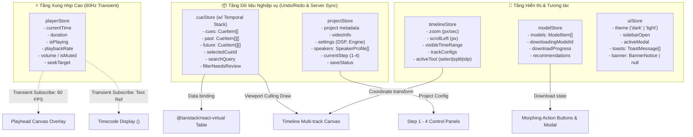

# KIẾN TRÚC FRONTEND STUDIO (DUBBING-VIDEO)

> **Phiên bản**: 2.0.0  
> **Trạng thái**: Draft / Đang thiết kế kiến trúc  
> **Mục tiêu**: Xây dựng lại toàn bộ giao diện Studio chuyên nghiệp theo chuẩn CapCut-lite trên nền tảng **React 19 + TypeScript + Vite + Meta Astryx (@astryxdesign/core, StyleX)**, cam kết hiệu năng 60 FPS ổn định với dự án video dài trên 2.000 câu thoại.

---

## 1. TỔNG QUAN HỆ THỐNG & NGUYÊN TẮC THIẾT KẾ

### 1.1. Bối cảnh & Yêu cầu cốt lõi
Hệ thống `dubbing-video` là một Studio lồng tiếng video tự động và bán tự động AI chạy hoàn toàn offline (Local). Khi người dùng xử lý video dài (từ 20 phút đến 2 tiếng, tương đương 500 – 2.500+ câu thoại), các giao diện React thông thường gặp tình trạng suy giảm FPS trầm trọng (Dropping frame, gõ text bị trễ, tua timeline giật lag) do:
1. Re-render lan truyền từ xung nhịp phát video (60Hz của Playhead) lan sang bảng câu thoại và cây DOM component.
2. DOM Node quá tải nếu vẽ hàng ngàn phần tử phụ đề trên timeline hoặc bảng cuộn.
3. Đồng bộ hai chiều giữa Player, Timeline Canvas và Virtual Table thiếu cơ chế phân tách tầng dữ liệu.

### 1.2. 5 Nguyên tắc vàng của Kiến trúc mới
1. **Isolated State Architecture (Tách biệt tuyệt đối trạng thái 60Hz)**: Tách riêng nhịp tim của video (`playerStore`) khỏi dữ liệu nghiệp vụ (`cueStore`, `projectStore`).
2. **Transient Subscriptions**: Playhead và Time-display chỉ sử dụng cơ chế subscribe trực tiếp từ Zustand (`usePlayerStore.subscribe`) để vẽ lên Canvas hoặc cập nhật trực tiếp `ref.textContent`, tuyệt đối không trigger React Component Re-render.
3. **Double Canvas Multi-Track Timeline**: Timeline sử dụng HTML5 2D Canvas kết hợp Viewport Culling theo thuật toán Binary Search; Playhead được tách riêng trên Canvas Overlay độc lập.
4. **Strict Design System Swizzling**: Toàn bộ UI component swizzle từ Astryx được đặt trong `src/design-system/`, thuần túy UI (Stateless hoặc UI-state only), không chứa business logic của dubbing.
5. **Fail-safe Error Handling**: Mọi tương tác API/SSE chuẩn hóa theo RFC 7807, dẫn truyền qua `apiClient` tập trung và hiển thị qua `uiStore` Toast/Banner có `ErrorBoundary` bảo vệ.

---

## 2. KIẾN TRÚC 6 ZUSTAND STORES

Hệ thống phân rã thành 6 Stores chuyên biệt, độc lập trách nhiệm (Single Responsibility):



### 2.1. `playerStore` (High-frequency, Transient)
- **Mục đích**: Lưu trữ trạng thái playback của video player và audio engine.
- **Tần suất cập nhật**: ~60 lần/giây khi video đang phát.
- **Quy tắc**:
  - TUYỆT ĐỐI KHÔNG hook `const currentTime = usePlayerStore(s => s.currentTime)` vào các component cha như `App`, `VirtualCueTable`, `TimelineContainer`.
  - Chỉ các component cần thiết (như Video HTML element hoặc Timecode span) đọc giá trị này hoặc đăng ký qua `usePlayerStore.subscribe((state) => ...)`.
- **State Interface**:
  ```typescript
  interface PlayerState {
    currentTime: number;
    duration: number;
    isPlaying: boolean;
    volume: number;
    isMuted: boolean;
    playbackRate: number;
    seekTarget: number | null;
    activeCueText: string;

    setCurrentTime: (time: number) => void;
    setDuration: (duration: number) => void;
    setIsPlaying: (playing: boolean) => void;
    setVolume: (volume: number) => void;
    setIsMuted: (muted: boolean) => void;
    setPlaybackRate: (rate: number) => void;
    seekTo: (time: number) => void;
    clearSeekTarget: () => void;
    togglePlay: () => void;
  }
  ```

### 2.2. `cueStore` (Data & Temporal Undo/Redo)
- **Mục đích**: Quản lý danh sách câu thoại (`cues`), hỗ trợ Undo/Redo lịch sử chỉnh sửa (tối đa 50 bước) và bộ lọc tìm kiếm.
- **State Interface**:
  ```typescript
  interface CueHistoryState {
    past: CueItem[][];
    future: CueItem[][];
  }

  interface CueState {
    cues: CueItem[];
    selectedCueId: number | null;
    searchQuery: string;
    filterNeedsReview: boolean;
    isSyncing: boolean;

    // Temporal actions (Undo/Redo)
    undo: () => void;
    redo: () => void;
    canUndo: boolean;
    canRedo: boolean;

    // CRUD & Mutations
    setCues: (cues: CueItem[], recordHistory?: boolean) => void;
    updateCue: (id: number, updates: Partial<CueItem>) => void;
    updateBatchCues: (updates: { id: number; patch: Partial<CueItem> }[]) => void;
    splitCue: (id: number, splitTime: number, firstText?: string, secondText?: string) => void;
    mergeCues: (id1: number, id2: number) => void;
    deleteCue: (id: number) => void;
    addCue: (cue: Omit<CueItem, 'id'>) => void;
    setSelectedCueId: (id: number | null) => void;
    setSearchQuery: (query: string) => void;
    setFilterNeedsReview: (filter: boolean) => void;
  }
  ```

### 2.3. `timelineStore` (Viewport & Transform Coordinates)
- **Mục đích**: Quản lý tỉ lệ co giãn thời gian (zoom: pixel/giây), vị trí cuộn ngang (`scrollLeft`), chiều cao từng track, vùng thời gian nhìn thấy (`visibleTimeRange: [startSec, endSec]`), và công cụ biên tập hiện thời.
- **State Interface**:
  ```typescript
  export type TimelineTool = 'select' | 'split' | 'slip';

  interface TrackConfig {
    id: 'video' | 'original-audio' | 'cues' | 'tts-audio';
    name: string;
    height: number;
    visible: boolean;
    locked: boolean;
  }

  interface TimelineState {
    zoom: number; // pixels per second (min: 20, max: 500, default: 80)
    scrollLeft: number; // horizontal scroll offset in pixels
    viewportWidth: number; // width of canvas container in pixels
    tracks: TrackConfig[];
    activeTool: TimelineTool;
    snappingEnabled: boolean;
    snapTolerancePx: number;

    setZoom: (zoom: number) => void;
    setScrollLeft: (scrollLeft: number) => void;
    setViewportWidth: (width: number) => void;
    setActiveTool: (tool: TimelineTool) => void;
    toggleTrackVisibility: (trackId: string) => void;
    setTrackHeight: (trackId: string, height: number) => void;
    setSnappingEnabled: (enabled: boolean) => void;
    
    // Selectors
    getVisibleTimeRange: () => [number, number]; // [startTimeSec, endTimeSec]
    timeToPixel: (timeSec: number) => number;
    pixelToTime: (pixelX: number) => number;
  }
  ```

### 2.4. `projectStore` (Project Lifecycle & Settings)
- **Mục đích**: Đồng bộ metadata dự án từ `project.json`, cấu hình thuật toán lồng tiếng, danh sách nhân vật (Speaker Profiles), tiến trình bước 1-4, và trạng thái lưu trữ server.
- **State Interface**:
  ```typescript
  interface ProjectState {
    project: Project | null;
    activeStep: 1 | 2 | 3 | 4;
    backendConnected: boolean;
    gpuInfo: HardwareInfo | null;
    isLoading: boolean;
    isSaving: boolean;
    lastSavedAt: string | null;

    setProject: (project: Project | null) => void;
    setActiveStep: (step: 1 | 2 | 3 | 4) => void;
    setBackendConnected: (connected: boolean) => void;
    updateSettings: (settings: Partial<DubbingSettings>) => void;
    addSpeaker: (speaker: SpeakerProfile) => void;
    updateSpeaker: (speakerId: string, updates: Partial<SpeakerProfile>) => void;
    removeSpeaker: (speakerId: string) => void;
    setExportInfo: (info: ExportInfo) => void;
    loadProject: (projectId: string) => Promise<boolean>;
    saveProject: () => Promise<boolean>;
  }
  ```

### 2.5. `modelStore` (Single-Download Queue & AI Provisioning)
- **Mục đích**: Quản lý danh mục mô hình AI (Whisper, Hy-MT2, VieNeu), đảm bảo cơ chế khoá tải đơn nhiệm (`downloadingModelId`), bắt stream tiến độ SSE và ánh xạ trạng thái sang Smart Action Buttons.
- **State Interface**:
  ```typescript
  interface DownloadProgress {
    modelId: string;
    percent: number;
    downloadedMb: number;
    totalMb: number;
    isDownloading: boolean;
    error?: string;
  }

  interface ModelState {
    models: ModelItem[];
    hardware: HardwareInfo | null;
    recommended: HardwareRecommendation;
    isLoading: boolean;
    downloadingModelId: string | null;
    downloads: Record<string, DownloadProgress>;

    fetchModels: () => Promise<void>;
    downloadModel: (modelId: string) => Promise<boolean>;
    isDownloaded: (modelId: string) => boolean;
    isDownloading: (modelId: string) => boolean;
    getModel: (modelId: string) => ModelItem | undefined;
  }
  ```

### 2.6. `uiStore` (Theme, Modals & Toast Notifications)
- **Mục đích**: Quản trị theme Dark/Light, kích thước layout thu gọn (collapsible panels), các hộp thoại Modal (ModelHub, ShortCut, Settings) và hàng đợi thông báo lỗi tập trung.
- **State Interface**:
  ```typescript
  export type ThemeMode = 'dark' | 'light';

  export interface ToastMessage {
    id: string;
    type: 'success' | 'info' | 'warning' | 'error';
    title: string;
    description?: string;
    durationMs?: number;
  }

  export interface BannerNotice {
    id: string;
    type: 'warning' | 'error' | 'info';
    message: string;
    actionText?: string;
    onAction?: () => void;
  }

  interface UIState {
    theme: ThemeMode;
    sidebarCollapsed: boolean;
    inspectorCollapsed: boolean;
    activeModal: 'modelHub' | 'settings' | 'shortcuts' | null;
    toasts: ToastMessage[];
    banner: BannerNotice | null;

    setTheme: (theme: ThemeMode) => void;
    toggleTheme: () => void;
    toggleSidebar: () => void;
    toggleInspector: () => void;
    openModal: (modal: 'modelHub' | 'settings' | 'shortcuts') => void;
    closeModal: () => void;
    addToast: (toast: Omit<ToastMessage, 'id'>) => void;
    removeToast: (id: string) => void;
    setBanner: (banner: BannerNotice | null) => void;
  }
  ```

---

## 3. CẤU TRÚC THƯ MỤC CHUẨN HOÁ

```
frontend/src/
├── app/                              # Khởi tạo ứng dụng & Providers
│   ├── App.tsx                       # Component gốc định hình Layout Shell
│   ├── main.tsx                      # Entrypoint Vite, nạp StyleX CSS & Root
│   └── routes.tsx                    # Điều hướng view (nếu mở rộng)
│
├── design-system/                    # 🛡️ PURE UI COMPONENTS (Swizzle từ Astryx)
│   ├── Button/                       # Nút bấm đa biến thể (solid, outline, ghost)
│   ├── Input/                        # Ô nhập liệu text, number
│   ├── Select/                       # Dropdown chọn lựa chuẩn accessibility
│   ├── Slider/                       # Thanh trượt cho volume, speed, zoom
│   ├── Dialog/                       # Modal window & backdrop
│   ├── Tooltip/                      # Gợi ý phím tắt & giải nghĩa
│   ├── Badge/                        # Tag trạng thái, Speaker tag, Model tag
│   ├── Tabs/                         # Chuyển tab trong Inspector & Steps
│   ├── Toast/                        # Toast thông báo góc màn hình
│   ├── DropdownMenu/                 # Menu ngữ cảnh khi click chuột phải
│   └── index.ts                      # Barrel export của design-system
│
├── theme/                            # 🎨 STYLEX THEME & DESIGN TOKENS
│   ├── tokens.stylex.ts              # Định nghĩa token trừu tượng (colors, spacing, radii)
│   ├── darkTheme.stylex.ts           # Token overrides cho Dark Studio Theme
│   ├── lightTheme.stylex.ts          # Token overrides cho Light Theme
│   └── global.css                    # Thiết lập reset CSS, scrollbars & font-family
│
├── core/                             # ⚙️ SYSTEM CORE & NETWORK LAYER
│   ├── apiClient.ts                  # Fetch client tập trung, timeout, RFC 7807 handler
│   ├── errorMapper.ts                # Ánh xạ error code sang thông điệp tiếng Việt thân thiện
│   ├── sseClient.ts                  # Wrapper an toàn cho Server-Sent Events luồng tiến độ
│   ├── ErrorBoundary.tsx             # React ErrorBoundary ngăn ngừa crash trắng màn hình
│   └── env.ts                        # Biến môi trường & cấu hình API URL
│
├── stores/                           # 🧠 6 ZUSTAND STORES CÔ LẬP
│   ├── playerStore.ts                # 60Hz Transient Player store
│   ├── cueStore.ts                   # Cues data + Undo/Redo temporal stack
│   ├── timelineStore.ts              # Timeline coordinates, zoom, track state
│   ├── projectStore.ts               # Project metadata & Step pipeline
│   ├── modelStore.ts                 # Model Hub & Single-download queue
│   └── uiStore.ts                    # Dark/Light theme, modals & toasts
│
├── features/                         # 🧩 FEATURE SLICES (Giao diện theo module)
│   ├── layout/                       # Khung ứng dụng
│   │   ├── StudioHeader.tsx          # Thanh công cụ trên cùng (Tên video, Theme, Health)
│   │   ├── StepNavigator.tsx         # Wizard chuyển 4 bước trực quan
│   │   ├── InspectorPanel.tsx        # Bảng thuộc tính bên phải (Speaker, DSP, Export info)
│   │   └── StatusBar.tsx             # Trạng thái GPU, VRAM, kết nối Backend
│   ├── player/                       # Trình phát video chuyên nghiệp
│   │   ├── VideoPlayer.tsx           # Video player wrapper (HTML5 Video + Canvas Overlay)
│   │   ├── VideoControls.tsx         # Tua, Play/Pause, Tốc độ, Âm lượng
│   │   └── SubtitleOverlay.tsx       # Phụ đề nổi trên video thời gian thực
│   ├── cues/                         # Quản lý danh sách câu thoại
│   │   ├── VirtualCueTable.tsx       # Bảng ảo hóa 60 FPS (@tanstack/react-virtual)
│   │   ├── CueRow.tsx                # Dòng câu thoại (memoized, tối ưu gõ phím)
│   │   ├── CueSearchFilter.tsx       # Tìm kiếm từ khóa, lọc câu cần xem xét
│   │   └── SpeakerSelect.tsx         # Gán nhân vật nhanh cho câu thoại
│   ├── timeline/                     # Multi-Track Canvas Timeline (CapCut-lite)
│   │   ├── CanvasTimeline.tsx        # Container chính bọc cả 2 lớp Canvas
│   │   ├── TimelineRuler.tsx         # Thước đo thời gian (Timecode ruler)
│   │   ├── MultiTrackCanvas.tsx      # Canvas tầng dưới vẽ Cues & Audio Waveforms
│   │   ├── PlayheadCanvas.tsx        # Canvas tầng trên vẽ kim chỉ giờ 60Hz
│   │   ├── TimelineToolbar.tsx       # Zoom slider, Snap toggle, Split tool
│   │   └── useTimelineRenderer.ts    # Custom hook tính toán tọa độ và culling
│   ├── steps/                        # Chi tiết 4 bước pipeline
│   │   ├── Step1Recognition.tsx      # Bước 1: Nhận diện ASR Whisper / OCR
│   │   ├── Step2Translation.tsx      # Bước 2: Dịch thuật Hy-MT2 1.8B
│   │   ├── Step3Narration.tsx        # Bước 3: Lồng tiếng VieNeu TTS
│   │   └── Step4Export.tsx           # Bước 4: Hòa âm Ducking & Xuất video
│   └── models/                       # Quản lý mô hình AI
│       ├── ModelHubModal.tsx         # Modal tải & xóa mô hình
│       ├── ModelCard.tsx             # Thẻ hiển thị dung lượng, trạng thái
│       └── MorphingActionButton.tsx  # Nút bấm thông minh (Tự chuyển Run -> Download)
│
├── types/                            # 📜 TYPESCRIPT CONTRACTS (Khớp schemas.py)
│   ├── project.ts                    # Project, Settings, VideoInfo, ExportInfo
│   ├── cue.ts                        # CueItem, CueUpdateItem
│   ├── speaker.ts                    # SpeakerProfile, VoiceItem
│   ├── model.ts                      # ModelItem, HardwareInfo, DownloadProgress
│   └── api.ts                        # RFC 7807 Error, API Request/Response
│
└── utils/                            # 🛠️ CÔNG CỤ TIỆN ÍCH
    ├── timeFormat.ts                 # Chuyển đổi giây <-> 00:00:00.000
    ├── canvasDraw.ts                 # Hàm vẽ hộp cue bo góc, text truncate, playhead
    └── binarySearch.ts               # Thuật toán tìm kiếm cue trong viewport O(log N)
```

---

## 4. CHIẾN LƯỢC CANVAS TIMELINE 60 FPS VỚI VIEWPORT CULLING

### 4.1. Vấn đề của DOM Timeline truyền thống
Khi video có trên 2.000 câu thoại, việc render 2.000 `<div>` thẻ phụ đề trên Timeline gây:
- DOM bloat: Mỗi thay đổi vị trí Playhead làm trình duyệt kích hoạt style calculation và compositing cho hàng ngàn node.
- Memory overhead: Chiếm dụng hàng trăm MB bộ nhớ RAM chỉ cho DOM tree.

### 4.2. Kiến trúc Hai Lớp Canvas (Dual-Layer Canvas Architecture)

```
┌──────────────────────────────────────────────────────────────────┐
│ TIMELINE CONTAINER (Chứa 2 thẻ <canvas> chồng khít tọa độ)       │
│                                                                  │
│  [ Lớp 2: PlayheadCanvas ] (Overlay, transparent, z-index: 10)  │
│  - Chỉ vẽ Kim Playhead & Vạch đỏ chỉ giờ                          │
│  - Chạy theo xung 60 FPS qua requestAnimationFrame                │
│  - Chỉ xóa và vẽ lại 1 dải hẹp xung quanh Playhead                │
│ ──────────────────────────────────────────────────────────────── │
│  [ Lớp 1: MultiTrackCanvas ] (Base Layer, z-index: 1)           │
│  - Chỉ vẽ lại khi: Cuộn ngang, Zoom, hoặc Thêm/Sửa câu thoại     │
│  - Không bị vẽ lại khi Playhead di chuyển                        │
│  - Áp dụng Viewport Culling O(log N): Chỉ duyệt và vẽ các cue     │
│    nằm trong khoảng [visibleStartTime, visibleEndTime]            │
└──────────────────────────────────────────────────────────────────┘
```

### 4.3. Thuật toán Viewport Culling & Binary Search
Giả sử có 2.000 câu thoại được sắp xếp tăng dần theo `startTime`:
1. Vùng nhìn thấy của Timeline:
   $$\text{visibleStartTime} = \frac{\text{scrollLeft}}{\text{zoom}}$$
   $$\text{visibleEndTime} = \frac{\text{scrollLeft} + \text{viewportWidth}}{\text{zoom}}$$
2. Thay vì duyệt qua toàn bộ 2.000 phần tử ($O(N)$), sử dụng thuật toán **Binary Search** để tìm chỉ số câu bắt đầu $i_{start}$ có $\text{endTime} \ge \text{visibleStartTime}$.
3. Lặp tuần tự từ $i_{start}$ đến khi gặp câu có $\text{startTime} > \text{visibleEndTime}$ thì dừng ngay lập tức.
4. Số lượng câu cần vẽ thực tế trên màn hình chỉ dao động từ **10 đến 40 câu**, đưa chi phí vẽ mỗi frame về mức dưới 1ms ($< 1\text{ms}$ execution time).

### 4.4. Đảm bảo độ sắc nét trên màn hình Retina / HiDPI
Mỗi canvas được cấu hình theo tỉ lệ `window.devicePixelRatio` để không bị mờ:
```typescript
function resizeCanvasToDisplaySize(canvas: HTMLCanvasElement) {
  const dpr = window.devicePixelRatio || 1;
  const width = canvas.clientWidth;
  const height = canvas.clientHeight;
  if (canvas.width !== width * dpr || canvas.height !== height * dpr) {
    canvas.width = width * dpr;
    canvas.height = height * dpr;
    const ctx = canvas.getContext('2d');
    ctx?.scale(dpr, dpr);
    return true;
  }
  return false;
}
```

---

## 5. HỆ THỐNG DESIGN TOKENS (STYLEX) & DARK/LIGHT THEME

Hệ thống màu sắc được quản lý 100% thông qua các tokens của StyleX tại `src/theme/tokens.stylex.ts`.

### 5.1. Bảng màu Dark Studio (Chế độ mặc định chuyên nghiệp)
- **Backgrounds**:
  - `bgApp`: `#0f1117` (Màu nền tổng thể)
  - `bgSurface0`: `#161922` (Thanh công cụ, status bar)
  - `bgSurface1`: `#1e2230` (Các panel điều khiển, card phụ đề)
  - `bgSurface2`: `#282e42` (Dòng được chọn, hover item)
  - `bgSurfaceActive`: `#343c56` (Trạng thái active, pressed)
- **Borders**:
  - `borderSubtle`: `#262c3d` (Viền chia cột, viền bảng)
  - `borderStrong`: `#3e4763` (Viền nút, viền focus)
- **Text & Foreground**:
  - `textPrimary`: `#f8fafc` (Độ tương phản cao nhất, chữ chính)
  - `textSecondary`: `#94a3b8` (Nhãn phụ, ghi chú)
  - `textMuted`: `#64748b` (Placeholder, disabled)
- **Brand & Accents**:
  - `accentPrimary`: `#3b82f6` (Xanh công nghệ chuyên dụng)
  - `accentHover`: `#2563eb`
  - `accentSuccess`: `#22c55e` (Model sẵn sàng, xuất thành công)
  - `accentWarning`: `#f59e0b` (Câu cần review, audio bị đè)
  - `accentDanger`: `#ef4444` (Lỗi CUDA, xóa dữ liệu)
- **Timeline Specific**:
  - `timelineRuler`: `#64748b`
  - `timelinePlayhead`: `#ef4444`
  - `timelineCueBox`: `#1e3a5f`
  - `timelineCueBoxBorder`: `#3b82f6`
  - `timelineAudioWaveform`: `#10b981`

### 5.2. Chuyển đổi Dark/Light linh hoạt
Khi chuyển sang `light` theme (qua thuộc tính `data-theme="light"` trên thẻ `<html>` hoặc StyleX theme class), các token tự động map sang bảng màu tương phản nhẹ nhàng cho văn phòng (Surface trắng ngà, Text đen đậm, Border xám mềm) mà không làm thay đổi cấu trúc component.

---

## 6. MA TRẬN ĐÁP ỨNG GIAO DIỆN (RESPONSIVE LAYOUT MATRIX)

Studio được thiết kế chuyên biệt cho công việc biên tập máy tính để bàn (Desktop Studio), phân định theo 3 ngưỡng phân giải:

```
┌────────────────────────────────────────────────────────────────────────────────────────┐
│ 1. MÀN HÌNH RỘNG (>= 1440px) — 3-CỘT ĐỘC LẬP TỐI ĐA NĂNG SUẤT                         │
│ ┌───────────────┬──────────────────────────────────────┬─────────────────────────────┐ │
│ │ Step Pipeline │ Video Preview & Controls             │ Virtual Cue Table           │ │
│ │ & AI Settings │ ──────────────────────────────────── │ (Danh sách câu thoại cuộn)  │ │
│ │ (320px)       │ Dual-Layer Canvas Timeline (60 FPS)  │ & Inspector Panel (380px)   │ │
│ └───────────────┴──────────────────────────────────────┴─────────────────────────────┘ │
├────────────────────────────────────────────────────────────────────────────────────────┤
│ 2. MÀN HÌNH TIÊU CHUẨN (1280px - 1439px) — 2 CỘT TỰ ĐỘNG THU GỌN                       │
│ ┌──────────────────────────────────────┬─────────────────────────────────────────────┐ │
│ │ Video Preview & Timeline Canvas      │ Virtual Cue Table (Kèm Drawer mở rộng       │ │
│ │ (Chiếm 60% chiều ngang)              │ cho Step Settings & Inspector) (Chiếm 40%)  │ │
│ └──────────────────────────────────────┴─────────────────────────────────────────────┘ │
├────────────────────────────────────────────────────────────────────────────────────────┤
│ 3. MÀN HÌNH COMPACT (< 1280px) — TABBED WORKSPACE LINH HOẠT                            │
│ ┌────────────────────────────────────────────────────────────────────────────────────┐ │
│ │ Tab Bar: [ 🎬 Preview & Timeline ]  |  [ 📝 Bảng câu thoại ]  |  [ ⚙️ Cài đặt ]    │ │
│ │ (Hiển thị toàn màn hình theo Tab đang chọn, bảo toàn độ mượt của Timeline Canvas)  │ │
│ └────────────────────────────────────────────────────────────────────────────────────┘ │
└────────────────────────────────────────────────────────────────────────────────────────┘
```

---

## 7. CƠ CHẾ XỬ LÝ LỖI TẬP TRUNG (RFC 7807 & ERROR BOUNDARY)

### 7.1. Chuẩn hóa Lỗi RFC 7807 (`src/core/apiClient.ts`)
Mọi phản hồi lỗi từ FastAPI Backend đều tuân theo chuẩn RFC 7807:
```json
{
  "error": {
    "code": "CUDA_OUT_OF_MEMORY",
    "message": "Không đủ bộ nhớ VRAM để khởi chạy mô hình Whisper Medium.",
    "step": 1,
    "details": {
      "free_vram_mb": 420,
      "required_vram_mb": 2048
    }
  }
}
```

### 7.2. Ánh xạ Thông điệp Thân thiện (`src/core/errorMapper.ts`)
Chuyển đổi các mã lỗi kỹ thuật sang hành động cụ thể cho người dùng:
- `CUDA_OUT_OF_MEMORY`: "VRAM không đủ. Hãy chuyển sang mô hình Whisper Small hoặc dùng chế độ CPU trong Model Hub."
- `TASK_ALREADY_RUNNING`: "Tiến trình trước đang chạy hoặc đang được thu hồi. Hệ thống đã tự động dọn dẹp, vui lòng bấm chạy lại sau vài giây."
- `MODEL_NOT_FOUND`: "Chưa tìm thấy tệp mô hình trên máy. Nút bấm đã tự động chuyển sang trạng thái tải về."

### 7.3. `ErrorBoundary` Bảo vệ Ứng dụng
Bọc quanh các vùng quan trọng:
1. Root Application (Bảo vệ toàn trang).
2. Canvas Timeline (Nếu lỗi render canvas, fallback về danh sách câu thoại dạng bảng).
3. Video Player (Nếu lỗi codec video, hiển thị trình phát phụ trợ kèm nút tải lại).

---

## 8. TIÊU CHUẨN CHẤT LƯỢNG & VERIFICATION GATES

Mỗi Phase khi hoàn thành bắt buộc phải vượt qua bộ 3 kiểm tra nghiêm ngặt:
1. `npx tsc --noEmit`: 0 TypeScript error, strict type checking.
2. `npm run lint`: 0 ESLint / Oxlint warning hoặc error.
3. `npm run build`: Vite build thành công không lỗi cú pháp hay import gãy vỡ.
