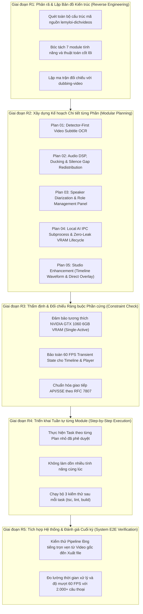

# TỔNG QUAN NGUỒN THAM KHẢO & QUY TRÌNH NGHIÊN CỨU CHUYỂN GIAO KIẾN TRÚC
> **Dự án mục tiêu**: `dubbing-video` (FastAPI + React 19 + StyleX / Astryx, tối ưu GTX 1060 6GB VRAM, 60 FPS)  
> **Nguồn tham khảo chuyên sâu**: `lemyloi-dichvideos` (Next.js 16 + React 19 + Headless Core + Video Editor Monorepo)  
> **Mục đích tài liệu**: Bóc tách toàn diện kiến trúc, giải thuật, giao diện và logic xử lý AI của nguồn tham khảo; thiết lập quy trình nghiên cứu (Research Workflow) và lộ trình kế hoạch từng phần (Sub-Plans) áp dụng cho `dubbing-video`.

---

## 1. BỐI CẢNH & PHẠM VI NGHIÊN CỨU

Kho mã nguồn tham khảo `lemyloi-dichvideos` là một hệ thống biên tập video và phòng thu lồng tiếng AI đa năng chạy Local + Web. Dự án này chứa đựng các giải thuật cốt lõi và các cầu nối AI (ASR, OCR, MT, TTS, Audio DSP) được tối ưu hóa sâu sắc cho bài toán nghiên cứu khoa học (NCKH) lồng tiếng video tự động.

### Ma trận So sánh Kiến trúc Tổng thể

| Hạng mục | Nguồn tham khảo (`lemyloi-dichvideos`) | Dự án Hiện tại (`dubbing-video`) | Chiến lược chuyển giao & Kế hoạch |
| :--- | :--- | :--- | :--- |
| **Kiến trúc App** | Monorepo Next.js 16 App Router + Bun + Turborepo; Web + Desktop (Tauri/Electron wrapper). | Client-Server phân tách: FastAPI Core (`127.0.0.1:8765`) + Vite React 19 Frontend. | Giữ nguyên Client-Server FastAPI + Vite; tiếp thu trọn vẹn mô hình dữ liệu và giải thuật nghiệp vụ. |
| **Core State** | Headless Core OOP (`EditorCore` Singleton với 10 Managers: Command, Timeline, Audio, Save...). | 6 Zustand Stores độc lập (`playerStore`, `cueStore`, `timelineStore`, `projectStore`, `modelStore`, `uiStore`). | Ánh xạ logic của các Managers vào 6 Zustand Stores và Service Adapters tương ứng. |
| **Xử lý Timeline** | React DOM elements (`TimelineElement` với `React.memo` custom comparator) + Canvas Renderer cho Preview. | Dual-Layer HTML5 2D Canvas 60 FPS với Viewport Culling Binary Search $O(\log N)$. | Giữ nguyên Canvas Timeline 60 FPS; bổ sung Audio Waveforms, Thumbnail Strip, Snapping và Selection Overlay từ nguồn. |
| **Video Subtitle OCR** | `ocr_video_pipeline.py`: Detector-First Event-Driven OCR (Tier A Fast Scanner + Temporal Ink Fusion + Tier B One-Shot OCR). | Đang ở mức gọi cơ bản qua model manager. | Chuyển giao trọn vẹn thuật toán Detector-First 2 tầng giúp giảm 90% tải OCR và chống chớp chữ. |
| **Audio DSP & Lồng tiếng** | `gap-expansion.ts`, `duck-envelope.ts`, `narration-timing.ts`, `vocal_isolation_worker.py`. | Audio ducking cơ bản trong `audio_mixer.py`. | Tích hợp thuật toán mượn khoảng lặng 2 chiều theo cú pháp tiếng Việt, nối chuỗi vế câu và tách nhạc nền Spleeter. |
| **Speaker Diarization** | `speaker_diarization_runner.py` + `speaker-role-panel.tsx` (quản trị đại từ xưng hô, gán giọng). | Danh sách Speaker đơn giản trong `projectStore`. | Chuyển giao hệ thống phân vai nhân vật hoàn chỉnh (vai trò, đại từ xưng hô cho prompt dịch, màu sắc, giọng đọc). |
| **Local AI Bridges** | Python Subprocess JSON-lines bridges (`nckh_*_runner.py`, `vieneu_tts_worker.py`). | Model Manager nạp module trực tiếp / Sidecar llama-server. | Ánh xạ cơ chế IPC bền bỉ (Windows UTF-8, lọc ký tự surrogate cấm, xử lý timeout). |

---

## 2. QUY TRÌNH NGHIÊN CỨU & TRIỂN KHAI 5 GIAI ĐOẠN (WORKFLOW)

Để đảm bảo quá trình tiếp thu kiến trúc diễn ra khoa học, chuẩn xác, **tuyệt đối không viết code vội vàng trước khi có bản kế hoạch chi tiết** và kiểm soát rủi ro triệt để theo từng phần nhỏ, workflow nghiên cứu được thiết kế gồm 5 giai đoạn:

---

## 3. DANH MỤC CÁC BẢN KẾ HOẠCH CON (SUB-PLANS INDEX)

Hệ thống tài liệu nghiên cứu và kế hoạch chi tiết được phân rã thành 5 tài liệu chuyên sâu độc lập trong thư mục `docs/plans/`:

1. [01_PLAN_OCR_DETECTOR_FIRST.md](file:///d:/NCKH/Goc/dubbing-video/docs/plans/01_PLAN_OCR_DETECTOR_FIRST.md)
   - **Nội dung**: Kiến trúc OCR 2 tầng (Tier A Fast Scanner + Tier B One-Shot OCR), bộ nhớ đệm Temporal Ink Fusion, thuật toán gộp sự kiện phụ đề, vùng quét ROI tương tác trực tiếp trên màn hình video.
2. [02_PLAN_AUDIO_DSP_DUCKING_GAP_EXPANSION.md](file:///d:/NCKH/Goc/dubbing-video/docs/plans/02_PLAN_AUDIO_DSP_DUCKING_GAP_EXPANSION.md)
   - **Nội dung**: Phân bổ khoảng lặng 2 chiều (Bidirectional Silence Gap Redistribution) kết hợp phân tích ngữ pháp tiếng Việt, thuật toán nối chuỗi câu thoại (Chained Narration Placement), Audio Ducking đường cong Attack/Release và tách nhạc nền Spleeter.
3. [03_PLAN_SPEAKER_DIARIZATION_AND_ROLE_PANEL.md](file:///d:/NCKH/Goc/dubbing-video/docs/plans/03_PLAN_SPEAKER_DIARIZATION_AND_ROLE_PANEL.md)
   - **Nội dung**: Tự động phân tách người nói bằng mô hình PyAnnote/Clustering, giao diện bảng phân vai nhân vật (Speaker Profiles), cấu hình đại từ xưng hô cho prompt dịch thuật và đồng bộ mã màu trên Timeline.
4. [04_PLAN_LOCAL_AI_BRIDGES_AND_WORKERS.md](file:///d:/NCKH/Goc/dubbing-video/docs/plans/04_PLAN_LOCAL_AI_BRIDGES_AND_WORKERS.md)
   - **Nội dung**: Cầu nối IPC Subprocess qua JSON-lines, xử lý mã hóa UTF-8 trên Windows, dọn dẹp ký tự surrogate cấm, cơ chế Single-Active Engine khóa GPU mutex và quản lý vòng đời VRAM 6GB không rò rỉ.
5. [05_PLAN_TIMELINE_AND_PREVIEW_STUDIO_ENHANCEMENT.md](file:///d:/NCKH/Goc/dubbing-video/docs/plans/05_PLAN_TIMELINE_AND_PREVIEW_STUDIO_ENHANCEMENT.md)
   - **Nội dung**: Bổ sung hiển thị sóng âm Audio Waveform và dải ảnh Thumbnail Strip trên Canvas Timeline, công cụ nam châm Snapping (hít mép), lớp phủ tương tác trực tiếp Selection Overlay & Smart GuideLines trên Video Player.
6. [06_PLAN_TIMELINE_CAPCUT_PRO_DIRECT_MANIPULATION.md](file:///d:/NCKH/Goc/dubbing-video/docs/plans/06_PLAN_TIMELINE_CAPCUT_PRO_DIRECT_MANIPULATION.md)
   - **Nội dung**: Kế hoạch nâng cấp Timeline toàn diện theo chuẩn CapCut-Pro từ ảnh thực tế của `lemyloi`: Kéo thả dời khối câu thoại dọc thời gian (Move Cue), Viền đỏ phát sáng + 2 núm kéo đỏ bo góc vạch trắng (ResizeHandle), Cột Track Headers (Left Sidebar w-28) với nút Mute và Popover thanh trượt âm lượng Video gốc (0% - 200%), bộ công cụ Cắt/Xén/Ghép câu chuyên nghiệp.

---

## 4. QUY TẮC BẢO TOÀN KIẾN TRÚC HIỆN TẠI CỦA DUBBING-VIDEO

Khi triển khai các kế hoạch trên vào `dubbing-video`, bắt buộc phải tuân thủ nghiêm ngặt 4 nguyên tắc bất biến:
1. **Quy tắc 60 FPS Transient**: Không đẩy state có tần suất cập nhật cao (như Playhead, thời gian phát, tọa độ kéo thả chuột) vào cây component React. Mọi biểu diễn thời gian thực phải đi qua Canvas Overlay hoặc Direct Ref manipulation (`usePlayerStore.subscribe`).
2. **Quy tắc 6GB VRAM & Single-Active Lock**: Tại bất kỳ thời điểm nào, chỉ duy nhất 1 mô hình AI nặng được phép chiếm dụng VRAM. Phải giải phóng VRAM bằng `gc.collect()` và `torch.cuda.empty_cache()` trước khi chuyển sang bước kế tiếp.
3. **Quy tắc RFC 7807 Error Handling**: Mọi lỗi từ backend trả về phải tuân thủ cấu trúc chuẩn (`type`, `title`, `status`, `detail`, `code`), không được để xảy ra tình trạng crash im lặng hoặc nuốt lỗi.
4. **Quy tắc Verification Gates**: Mỗi bước nhỏ (Task) sau khi hiện thực phải vượt qua bộ 3 lệnh kiểm tra (`npx tsc --noEmit`, `npm run lint`, `npm run build`) và kiểm thử chức năng trước khi chuyển sang task tiếp theo.
