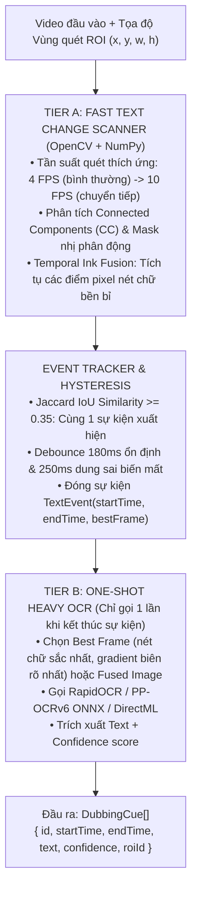

# KẾ HOẠCH CHI TIẾT: THUẬT TOÁN DETECTOR-FIRST EVENT-DRIVEN VIDEO SUBTITLE OCR
> **Mã kế hoạch**: `PLAN-01`  
> **Nguồn tham khảo**: `lemyloi-dichvideos/ocr_video_pipeline.py` (1.194 dòng) & `nckh_ocr_runner.py`  
> **Áp dụng cho**: `dubbing-video/backend/` (FastAPI) & `dubbing-video/frontend/` (Step 1 Recognition & Video Player)

---

## 1. PHÂN TÍCH CHUYÊN SÂU NGUỒN THAM KHẢO

### 1.1. Vấn đề của phương pháp OCR thông thường (Naive Frame-by-Frame OCR)
Trong các giải pháp OCR truyền thống, video được tách frame cố định (ví dụ 2 frame/giây) và gọi mô hình OCR (PaddleOCR hoặc EasyOCR) trên mọi frame:
- **Tốn tài nguyên**: Một video 10 phút sinh ra 1.200 frame. Mỗi frame tốn 100-300ms xử lý OCR trên GPU $\rightarrow$ tổng thời gian xử lý lên tới 2-6 phút, GPU nóng và nghẽn hàng đợi.
- **Rung giật văn bản (Subtitle Jitter/Flicker)**: Cùng một câu chữ xuất hiện trên 10 frame liên tiếp nhưng OCR có thể đọc ra các kết quả sai khác nhau đôi chút do nhiễu hậu cảnh, dẫn đến phụ đề bị chớp nháy và trùng lặp thời gian.
- **Không xác định chính xác mốc bắt đầu/kết thúc**: Mốc thời gian bị làm tròn theo tần suất mẫu của frame thay vì đúng thời điểm chữ xuất hiện/biến mất.

### 1.2. Giải pháp Đột phá của `ocr_video_pipeline.py` (Kiến trúc 2 tầng Tier A/B)



#### Chi tiết các tham số giải thuật trong `OCRConfig`:
1. **Tần số quét thích ứng (Adaptive Scan FPS)**:
   - `normal_scan_fps`: 4.0 FPS khi văn bản đang hiển thị ổn định.
   - `idle_scan_fps`: 2.0 FPS khi vùng ROI hoàn toàn trống (tiết kiệm CPU/GPU).
   - `transition_scan_fps`: 10.0 FPS khi phát hiện có biến đổi nét chữ (bắt chính xác đến từng frame thời điểm chữ xuất hiện hoặc biến mất).
2. **Bộ lọc Connected Components (CC Filtering)**:
   - `min_component_area`: 15 px (loại bỏ nhiễu hạt muối tiêu).
   - `max_component_area_ratio`: 0.50 (loại bỏ các mảng màu nền lớn hoặc chuyển cảnh toàn màn hình).
3. **Mặt nạ tích tụ thời gian (Temporal Ink Fusion)**:
   - Đối với phụ đề có hiệu ứng karaoke (chữ đổi màu từ từ) hoặc video chuyển động hậu cảnh, thuật toán tích tụ ma trận pixel xuất hiện ổn định qua $N \ge 2$ frame liên tiếp (`fusion_persistence_min = 2`), tạo ra một ảnh nét chữ tổng hợp không bị thủng nét trước khi đưa vào OCR.
4. **Bộ nhớ đệm chống nuốt chữ (Debounce & Missing Grace)**:
   - `stability_ms`: 180ms (chữ phải tồn tại tối thiểu 180ms mới tính là sự kiện hợp lệ).
   - `missing_grace_ms`: 250ms (nếu chữ biến mất dưới 250ms rồi xuất hiện lại thì vẫn duy trì là cùng 1 sự kiện, tránh bị xé nhỏ câu khi có vật thể lướt qua).

---

## 2. THIẾT KẾ ÁP DỤNG CHO DUBBING-VIDEO

### 2.1. Backend API & Quản lý Luồng
- **Endpoint mới**: `POST /api/recognition/ocr-stream` (sử dụng Server-Sent Events).
- **Request Body**:
  ```python
  class VideoOCRRequest(BaseModel):
      project_id: str
      video_path: str
      roi: ROIBox  # { x: float, y: float, width: float, height: float } (tỉ lệ 0.0 - 1.0)
      fps: float = 4.0
      language: str = "zh"  # zh, en, vi, ja, ko
      engine: str = "rapidocr-directml"  # rapidocr-directml, ppocr-onnx
  ```
- **SSE Stream Progress Format**:
  - `data: {"type": "progress", "percent": 45.2, "currentTime": 124.5, "eventCount": 32}`
  - `data: {"type": "cue", "cue": {"id": 1, "start": 0.5, "end": 2.4, "text": "你好世界", "confidence": 0.96}}`
  - `data: {"type": "done", "totalCues": 85}`

### 2.2. Frontend UI: Vùng quét ROI tương tác trực tiếp
- Bổ sung `RoiSelectorOverlay.tsx` nổi trên màn hình xem trước video (`VideoPlayer.tsx`).
- Cho phép người dùng kéo thả chuột để tạo hộp chữ nhật màu xanh lá bao quanh khu vực hiển thị phụ đề của video gốc (thường nằm ở 15-20% phía dưới video).
- Tọa độ được chuẩn hóa tỉ lệ $0.0 - 1.0$ lưu vào `projectStore.settings.ocrRoi`.

---

## 3. PHÂN KỲ NHIỆM VỤ CHI TIẾT (TASK BREAKDOWN)

> [!IMPORTANT]
> Toàn bộ các task dưới đây chỉ thực hiện sau khi kế hoạch được phê duyệt. Không chỉnh sửa code trước.

- [ ] **Task 1.1: Đặc tả và cấu trúc hóa module OCR Pipeline trong Backend**
  - Tạo `backend/ocr_pipeline/` chứa:
    - `roi.py`: Dataclass `ROI` với phương thức chuẩn hóa clamp tọa độ.
    - `config.py`: Dataclass `OCRConfig` đầy đủ các ngưỡng thích ứng FPS và debounce.
    - `fast_scanner.py`: Tier A OpenCV/NumPy lọc nhị phân, Connected Components và Temporal Ink Fusion.
    - `event_tracker.py`: Quản lý vòng đời `TextEvent` (start, update, close) và tính IoU similarity.
- [ ] **Task 1.2: Triển khai Tier B One-Shot OCR Integration**
  - Tích hợp `RapidOCR` ONNX DirectML chạy trên GPU hoặc CPU.
  - Cơ chế chọn frame tối ưu (`select_best_frame`): tính điểm sắc nét thông qua toán tử Sobel/Laplacian gradient trên vùng chữ.
- [ ] **Task 1.3: Triển khai SSE Stream Endpoint trong FastAPI**
  - Viết endpoint `POST /api/recognition/ocr-stream` trong `backend/server.py`.
  - Kết nối với cơ chế `acquire_slot()` của `Single-Active Engine`, đảm bảo giải phóng VRAM ngay sau khi hoàn thành.
- [ ] **Task 1.4: Xây dựng Component ROI Selector trên Frontend**
  - Tạo `src/features/recognition/RoiSelectorOverlay.tsx` trong `frontend/`.
  - Hỗ trợ thao tác kéo vẽ khung chữ nhật, di chuyển khung và co giãn 4 góc.
- [ ] **Task 1.5: Tích hợp vào Step 1 Recognition & VirtualCueTable**
  - Nối luồng dữ liệu từ SSE stream trực tiếp vào `cueStore.setCues()`.
  - Tự động cuộn `VirtualCueTable` theo tiến độ nhận diện.

---

## 4. TIÊU CHÍ NGHIỆM THU (VERIFICATION GATES)

1. **Hiệu năng xử lý**: Tốc độ quét đạt tối thiểu $\ge 5\times$ thời gian thực (video 1 phút quét xong trong dưới 12 giây trên GPU GTX 1060).
2. **Độ chính xác thời gian**: Sai số mốc bắt đầu/kết thúc câu thoại không vượt quá $\pm 100\text{ms}$ so với thực tế hiển thị trên video.
3. **Chống trùng lặp**: Không sinh ra 2 câu thoại trùng lặp nội dung tại cùng một khoảng thời gian.
4. **Vượt qua bộ 3 lệnh Frontend**: `npx tsc --noEmit`, `npm run lint`, `npm run build` PASS 100%.
