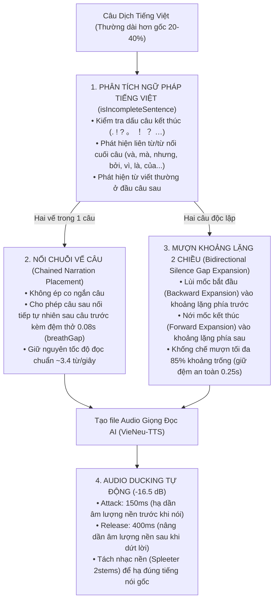

# KẾ HOẠCH CHI TIẾT: AUDIO DSP ENGINE, SILENCE GAP REDISTRIBUTION & AUDIO DUCKING
> **Mã kế hoạch**: `PLAN-02`  
> **Nguồn tham khảo**: `lemyloi-dichvideos/apps/web/src/dubbing/services/` (`gap-expansion.ts`, `duck-envelope.ts`, `narration-timing.ts`, `vocal_isolation_worker.py`)  
> **Áp dụng cho**: `dubbing-video/backend/audio_mixer.py` & `dubbing-video/frontend/src/features/` (Step 3 Narration & Step 4 Export)

---

## 1. PHÂN TÍCH CHUYÊN SÂU NGUỒN THAM KHẢO

### 1.1. Vấn đề nan giải trong Lồng tiếng AI (Dubbing Alignment)
Khi chuyển ngữ từ tiếng Trung hoặc tiếng Anh sang tiếng Việt, độ dài câu dịch thường **dài hơn từ 20% đến 45%** so với câu gốc.
- **Cách làm thông thường (Kém tự nhiên)**: Ép mô hình TTS đọc tăng tốc (Time-stretching lên 1.4x - 1.8x). Kết quả là giọng đọc bị "cháy máy", líu lưỡi, mất ngữ điệu tự nhiên, gây cảm giác ngột ngạt cho người nghe.
- **Nếu không tăng tốc**: Câu đọc bị tràn đè lên câu tiếp theo hoặc bị cắt cụt (Audio clipping).

### 1.2. Bộ 3 Giải thuật Đột phá từ Nguồn Tham khảo

#### Chi tiết Giải thuật 1: Phân tích Ngữ pháp Tiếng Việt & Nối chuỗi (`gap-expansion.ts`)
Hàm `isIncompleteSentence(prevText, nextText)` phát hiện chính xác các vế câu chưa kết thúc:
1. **Dấu ngắt lửng**: Đoạn trước kết thúc bằng `,`, `:`, `;`, `-`, `~`, `–`, `—`, `，`, `、`.
2. **Từ nối và hư từ tiếng Việt**: Các từ nối cuối câu như: `"và", "mà", "hoặc", "nhưng", "bởi", "vì", "đối với", "trong khi", "là", "của", "rằng", "thì", "ở", "với", "đã", "đang", "sẽ", "để", "cho", "nên", "nếu", "khi", "như", "về", "từ", "bằng", "theo", "do", "tại", "cùng", "cũng", "rồi", "lại", "vừa", "chưa", "không", "rất", "quá", "được", "bị", "phải", "muốn", "cần"`.
3. **Chữ cái đầu viết thường**: Nếu câu kế tiếp bắt đầu bằng chữ cái thường $\rightarrow$ khẳng định 100% là vế nối tiếp.
4. **Hành vi xử lý**: Thay vì gượng ép nhét câu vào khoảng thời gian ngắn của ASR, hệ thống áp dụng `planChainedNarrationPlacements()`: cho phép câu sau tiếp nối câu trước với khoảng đệm thở tự nhiên `breathGapSeconds = 0.08s`.

#### Chi tiết Giải thuật 2: Mượn Khoảng lặng 2 Chiều (`gap-expansion.ts`)
- **Tốc độ đọc tiếng Việt chuẩn**: `targetWordsPerSecond = 3.4` (từ/giây).
- **Thời lượng cần thiết**: $T_{\text{needed}} = \frac{\text{Số từ}}{3.4}$.
- **Khoảng thiếu hụt**: $\Delta T = \max(0, T_{\text{needed}} - T_{\text{original}})$.
- **Phân bổ 2 chiều**:
  - Mượn ngược (Backward): Lùi `startTime` về phía trước tối đa $50\% \times \Delta T$, nhưng không được lấn vào câu trước (giữ khoảng đệm an toàn `safetyPaddingSeconds = 0.25s`).
  - Mượn xuôi (Forward): Nới `endTime` về phía sau phần còn lại, tối đa $85\%$ độ rộng khoảng lặng tiếp theo (`maxGapBorrowRatio = 0.85`).
  - Khống chế trần: `maxBorrowSeconds = 3.5s` cho mỗi câu.

#### Chi tiết Giải thuật 3: Đường cong Audio Ducking chuyên nghiệp (`duck-envelope.ts`)
- Mức giảm âm lượng nền (Ducking Depth): $-16.5\text{ dB}$ (giảm còn $\approx 15\%$ âm lượng gốc).
- Thời gian dìm âm (Attack Time): $150\text{ms}$ tuyến tính/hàm logarit trước khi tiếng đọc bắt đầu.
- Thời gian hồi âm (Release Time): $400\text{ms}$ mượt mà sau khi tiếng đọc kết thúc.
- Phân tách vai trò âm thanh (Audio Roles):
  - `narration`: Track giọng đọc AI mới.
  - `source`: Video gốc chưa tách.
  - `music-stem`: Nhạc nền video sau khi tách bỏ tiếng nói cũ bằng Spleeter.
  - `ducked-source`: Track âm thanh nền đã áp dụng đường bao hạ âm (Ducked Envelope).

---

## 2. THIẾT KẾ ÁP DỤNG CHO DUBBING-VIDEO

### 2.1. Nâng cấp Backend DSP (`backend/audio_mixer.py`)
- **Tích hợp module Spleeter 2stems Offline**:
  - Tách luồng audio gốc thành `vocals.wav` và `accompaniment.wav` (nhạc nền và hiệu ứng âm thanh SFX).
  - Giữ lại `accompaniment.wav` làm nhạc nền vĩnh viễn, loại bỏ hoàn toàn tiếng nói gốc tiếng Trung/Anh để tránh hiện tượng nói đè "song ngữ".
- **Triển khai hàm dựng Envelope Vectorized (NumPy)**:
  - Khởi tạo mảng độ lợi `gain_curve = np.ones(total_samples, dtype=np.float32)`.
  - Với mỗi phân đoạn thuyết minh `[start, end]`:
    - Vùng trước lời thoại: nội suy tuyến tính từ $1.0$ xuống $0.15$ trong $150\text{ms}$.
    - Vùng trong lời thoại: giữ nguyên $0.15$ ($-16.5\text{ dB}$).
    - Vùng sau lời thoại: nội suy mượt từ $0.15$ lên $1.0$ trong $400\text{ms}$.
  - Nhân trực tiếp `accompaniment_samples * gain_curve` $\rightarrow$ đạt hiệu năng xử lý cực nhanh (dưới 1 giây cho 10 phút audio).

### 2.2. Nâng cấp Frontend Timeline & Cue Timing
- Bổ sung nút công tắc `[🧲 Tối ưu khoảng lặng thông minh]` trong Step 3 (`Step3Narration.tsx`).
- Khi bật: gọi hàm tính toán `expandCueGaps()` và cập nhật trực tiếp `startTime`, `endTime` hiển thị trên `CanvasTimeline`.
- Trên Canvas Timeline: Các câu mượn khoảng lặng được vẽ thêm dải viền mờ (Halo/Stripe) biểu thị phần thời gian được nới thêm.

---

## 3. PHÂN KỲ NHIỆM VỤ CHI TIẾT (TASK BREAKDOWN)

> [!IMPORTANT]
> Toàn bộ các task dưới đây chỉ thực hiện sau khi kế hoạch được phê duyệt. Không chỉnh sửa code trước.

- [ ] **Task 2.1: Xây dựng Module Ngữ pháp & Mượn khoảng lặng trong Frontend**
  - Tạo `src/features/narration/services/gapExpansion.ts`:
    - Triển khai `countWords()`, `isIncompleteSentence()`, `expandCueGaps()`.
  - Tạo `src/features/narration/services/narrationTiming.ts`:
    - Triển khai `planChainedNarrationPlacements()`.
- [ ] **Task 2.2: Tích hợp Module Vocal Isolation (Spleeter 2stems) trong Backend**
  - Bổ sung `backend/vocal_remover.py` sử dụng Spleeter hoặc Demucs nhẹ (chạy CPU hoặc GPU INT8).
  - Thêm endpoint `POST /api/audio/separate-stems` trả về SSE tiến trình tách nhạc nền.
- [ ] **Task 2.3: Viết lại Engine Ducking mượt mà trong `backend/audio_mixer.py`**
  - Triển khai hàm `apply_dynamic_ducking(bgm_path, narration_segments, attack_ms=150, release_ms=400, duck_db=-16.5)`.
  - Tối ưu hóa tính toán ma trận với NumPy mảng 32-bit float, tránh méo tiếng và vỡ âm (Clipping/Artifacts).
- [ ] **Task 2.4: Hiển thị Trực quan Đường bao Ducking trên Canvas Timeline**
  - Cập nhật `CanvasTimeline.tsx`: Vẽ một đường sóng âm hạ thấp biểu thị hiệu ứng Ducking tại các vị trí có câu thoại thuyết minh.
- [ ] **Task 2.5: Cập nhật Step 4 Export UI**
  - Thêm slider điều chỉnh mức độ dìm âm: `-12 dB` (nhẹ), `-16.5 dB` (chuẩn điện ảnh), `-24 dB` (rõ lời tối đa).
  - Thêm công tắc: `Giữ lại nhạc nền gốc (Đã tách lời)` vs `Tắt hẳn âm thanh gốc`.

---

## 4. TIÊU CHÍ NGHIỆM THU (VERIFICATION GATES)

1. **Chất lượng âm thanh thuyết minh**: Không còn hiện tượng nói dồn dập quá nhanh ($> 4.5$ từ/giây); các câu nối tiếp nghe tự nhiên như người thật đọc.
2. **Độ mượt của Ducking**: Không có tiếng "bụp" (Pop/Click noise) khi nhạc nền bị giảm hoặc tăng âm lượng. Chuyển tiếp êm ái qua các mốc 150ms và 400ms.
3. **Tách nhạc nền**: Lời thoại gốc tiếng Trung/Anh bị triệt tiêu $\ge 90\%$, giữ lại tiếng nhạc cụ và âm thanh môi trường nguyên vẹn.
4. **Vượt qua bộ 3 lệnh Frontend**: `npx tsc --noEmit`, `npm run lint`, `npm run build` PASS 100%.
