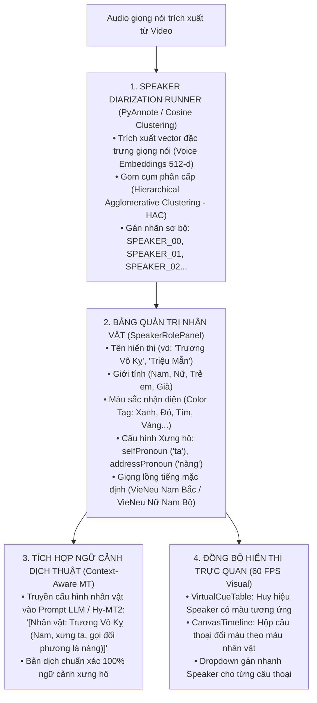

# KẾ HOẠCH CHI TIẾT: PHÂN VAI NHÂN VẬT (SPEAKER DIARIZATION) & QUẢN TRỊ VAI TRÒ
> **Mã kế hoạch**: `PLAN-03`  
> **Nguồn tham khảo**: `lemyloi-dichvideos/speaker_diarization_runner.py` & `apps/web/src/dubbing/components/speaker-role-panel.tsx`  
> **Áp dụng cho**: `dubbing-video/backend/` & `dubbing-video/frontend/src/features/cues/` + `projectStore`

---

## 1. PHÂN TÍCH CHUYÊN SÂU NGUỒN THAM KHẢO

### 1.1. Thực trạng Phân vai trong Video Đa nhân vật
Trong các video đối thoại (phim truyền hình, hoạt hình, phỏng vấn, vlog), nhiều nhân vật cùng nói chuyện:
- Nếu chỉ dùng 1 giọng đọc AI duy nhất cho toàn bộ video, người xem không thể phân biệt ai đang nói, câu chuyện trở nên đơn điệu và khó hiểu.
- Trong tiếng Việt, đại từ nhân xưng phụ thuộc sâu sắc vào mối quan hệ giữa người nói và người nghe (anh - em, thầy - trò, bố - con, ta - ngươi, tôi - bạn). Nếu mô hình dịch thuật AI không biết câu đó do ai nói với ai, bản dịch sẽ bị loạn xưng hô (lúc xưng "tôi", lúc xưng "anh", lúc xưng "chúng tôi").

### 1.2. Giải pháp Hoàn chỉnh từ Nguồn Tham khảo



#### Cấu trúc Dữ liệu `SpeakerProfile` hoàn chỉnh:
```typescript
export interface SpeakerProfile {
    id: string;              // "speaker-1", "speaker-2"
    name: string;            // "Tiêu Phong", "A Châu"
    gender: "male" | "female" | "child" | "elder";
    color: string;           // Mã màu HEX: "#3b82f6", "#ec4899"
    voiceId: string;         // "vieneu-male-north", "vieneu-female-south"
    selfPronoun?: string;    // "anh", "tôi", "ta", "bổn vương"
    addressPronoun?: string; // "em", "bạn", "nàng", "các hạ"
    pitchShift?: number;     // Tinh chỉnh cao độ giọng (-2 đến +2)
    speedFactor?: number;    // Tinh chỉnh tốc độ nói (0.8x đến 1.2x)
}
```

---

## 2. THIẾT KẾ ÁP DỤNG CHO DUBBING-VIDEO

### 2.1. Backend API: Diarization & Speaker Clustering
- **Endpoint mới**: `POST /api/recognition/diarize`
- **Thực thi**:
  - Tích hợp pipeline trích xuất vector giọng nói nhẹ chạy CPU/GPU.
  - Hỗ trợ tham số `--speakers auto` hoặc chỉ định số lượng nhân vật dự kiến (ví dụ: `2` người).
  - Trả về danh sách mốc thời gian kèm `speaker_id` để ánh xạ trực tiếp vào `CueItem`.

### 2.2. Frontend UI: Bảng Quản trị Nhân vật & Inline Speaker Tag
1. **Modal / Panel Quản trị Nhân vật (`SpeakerManagerDialog.tsx`)**:
   - Thêm / Sửa / Xóa nhân vật.
   - Bảng chọn màu sắc (Color Picker Preset 12 màu tương phản cao, dễ nhìn trong Dark Theme).
   - Chọn giọng đọc VieNeu mặc định cho từng nhân vật.
2. **Nâng cấp `VirtualCueTable` & `CueRow.tsx`**:
   - Thêm cột Speaker với Dropdown chọn nhanh: Click vào badge nhân vật để đổi sang nhân vật khác chỉ trong 1 thao tác.
   - Phím tắt gán nhanh: Nhấn `1`, `2`, `3` trên bàn phím khi đang focus vào dòng câu thoại để gán tức thời cho Speaker 1, 2, 3.
3. **Nâng cấp `CanvasTimeline.tsx`**:
   - Màu nền của hộp câu thoại trên Track Phụ đề và Track TTS tự động lấy theo `speaker.color` tương ứng, giúp người biên tập nhìn lướt qua toàn bộ timeline là biết ngay phân bố thời lượng nói của từng nhân vật.

---

## 3. PHÂN KỲ NHIỆM VỤ CHI TIẾT (TASK BREAKDOWN)

> [!IMPORTANT]
> Toàn bộ các task dưới đây chỉ thực hiện sau khi kế hoạch được phê duyệt. Không chỉnh sửa code trước.

- [ ] **Task 3.1: Nâng cấp kiểu dữ liệu `SpeakerProfile` trong `src/types/`**
  - Mở rộng interface `SpeakerProfile` với đầy đủ các trường `gender`, `color`, `selfPronoun`, `addressPronoun`, `voiceId`.
  - Cập nhật `projectStore.ts` để lưu trữ và quản trị mảng `speakers: SpeakerProfile[]`.
- [ ] **Task 3.2: Xây dựng UI Component `SpeakerRoleModal.tsx`**
  - Tạo hộp thoại quản lý nhân vật với giao diện StyleX / Astryx.
  - Cho phép người dùng chỉnh sửa tên, màu sắc, đại từ xưng hô và gán giọng đọc thử.
- [ ] **Task 3.3: Tích hợp Dropdown Phân vai trên `CueRow.tsx`**
  - Thay thế nhãn hiển thị speaker tĩnh hiện tại bằng `SpeakerDropdown` tương tác mượt mà.
  - Đảm bảo việc đổi speaker ghi nhận vào `cueStore` lịch sử Undo/Redo (`past`/`future`).
- [ ] **Task 3.4: Đồng bộ Màu sắc Nhân vật lên `CanvasTimeline.tsx`**
  - Cập nhật hàm vẽ hộp cue trong `src/utils/canvasDraw.ts`: ánh xạ `speakerId` $\rightarrow$ `speaker.color`.
  - Giữ độ mượt 60 FPS khi cuộn timeline có nhiều màu sắc khác nhau.
- [ ] **Task 3.5: Nạp Ngữ cảnh Nhân vật vào Prompt Dịch thuật (Step 2 Translation)**
  - Cập nhật logic tạo payload dịch thuật gửi sang Backend: đính kèm bảng đại từ xưng hô của các nhân vật tham gia vào đoạn thoại để LLM dịch chuẩn xác văn phong.

---

## 4. TIÊU CHÍ NGHIỆM THU (VERIFICATION GATES)

1. **Hiển thị trực quan**: Mọi câu thoại thuộc cùng một nhân vật đều hiển thị đúng mã màu đồng nhất trên cả `VirtualCueTable` và `CanvasTimeline`.
2. **Chất lượng bản dịch AI**: Khi gán `selfPronoun = "ta"` và `addressPronoun = "nàng"`, toàn bộ các câu thoại của nhân vật đó khi dịch sang tiếng Việt đều phản ánh đúng xưng hô, không bị lẫn lộn sang "tôi/bạn".
3. **Hiệu năng 60 FPS**: Thao tác đổi speaker và vẽ màu trên Canvas Timeline không làm giảm FPS xuống dưới 60 khung hình/giây.
4. **Vượt qua bộ 3 lệnh Frontend**: `npx tsc --noEmit`, `npm run lint`, `npm run build` PASS 100%.
