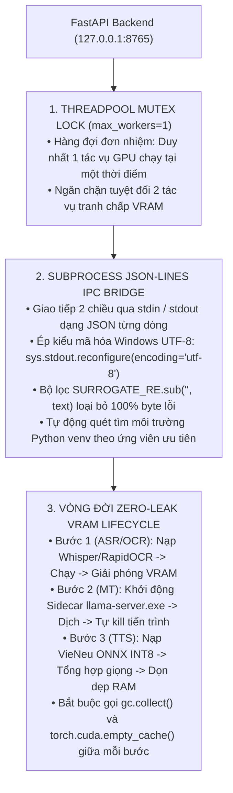

# KẾ HOẠCH CHI TIẾT: CẦU NỐI IPC SUBPROCESS LOCAL AI & VÒNG ĐỜI VRAM 6GB KHÔNG RÒ RỈ
> **Mã kế hoạch**: `PLAN-04`  
> **Nguồn tham khảo**: `lemyloi-dichvideos/` (`nckh_asr_runner.py`, `nckh_mt_runner.py`, `nckh_ocr_runner.py`, `vieneu_tts_worker.py`)  
> **Áp dụng cho**: `dubbing-video/backend/` (`model_manager.py`, `server.py`, `model_hub.py`)

---

## 1. PHÂN TÍCH CHUYÊN SÂU NGUỒN THAM KHẢO

### 1.1. Thách thức lớn của Hệ thống Local AI trên Windows & VRAM 6GB
Khi vận hành toàn bộ mô hình AI offline trên máy tính cá nhân người dùng (đặc biệt là GPU phổ thông NVIDIA GTX 1060 6GB VRAM):
1. **Xung đột bộ nhớ VRAM (CUDA Out Of Memory - OOM)**: Không thể nạp đồng thời Faster-Whisper, Qwen/Hy-MT2 LLM và VieNeu-TTS vào cùng 6GB VRAM.
2. **Lỗi mã hóa tiếng Việt trên Windows Console (cp1252 / cp936 vs UTF-8)**: Khi chạy subprocess trên Windows, luồng `stdout`/`stderr` mặc định dùng bảng mã hệ thống, gây lỗi vỡ font tiếng Việt hoặc crash `UnicodeDecodeError`.
3. **Ký tự cấm Unicode Surrogate (`\ud800` - `\udfff`)**: Một số tokenizer của LLM và Whisper sinh ra các byte nửa chừng không hợp lệ trong UTF-8. Khi gọi `json.dumps()` sẽ văng ngoại lệ `ValueError: surrogates not allowed`.
4. **Treo tiến trình (Subprocess Deadlock)**: Nếu tiến trình con ghi quá nhiều log vào buffer pipe mà tiến trình cha chưa kịp đọc, pipe bị đầy và toàn bộ hệ thống bị đóng băng vĩnh viễn.

### 1.2. Các Giải pháp Kỹ thuật Chuẩn mực từ Nguồn Tham khảo



#### Chi tiết Kỹ thuật 1: Xử lý UTF-8 & Ký tự Surrogate cấm trên Windows
Đoạn mã mẫu mực trong `nckh_mt_runner.py`:
```python
# Ép kiểu UTF-8 trên Windows console
if sys.platform == "win32":
    try:
        sys.stdout.reconfigure(encoding="utf-8", errors="replace")
        sys.stderr.reconfigure(encoding="utf-8", errors="replace")
        sys.stdin.reconfigure(encoding="utf-8", errors="replace")
    except Exception:
        pass

# Regex quét sạch mã surrogate U+D800 đến U+DFFF
SURROGATE_RE = re.compile(r"[\ud800-\udfff]")

def clean_surrogates(val: any) -> any:
    if isinstance(val, str):
        return SURROGATE_RE.sub("", val)
    elif isinstance(val, dict):
        return {clean_surrogates(k): clean_surrogates(v) for k, v in val.items()}
    elif isinstance(val, list):
        return [clean_surrogates(x) for x in val]
    return val
```

#### Chi tiết Kỹ thuật 2: Tự động Định vị Môi trường Python (Candidate Dirs Fallback)
Các runner trong nguồn tham khảo không bao giờ giả định cứng một đường dẫn duy nhất mà luôn có danh sách fallback đa tầng (`find_asr_dir`, `find_mt_python`):
```python
ASR_CANDIDATE_DIRS = [
    Path("d:/NCKH/Goc/asr-ocr"),
    PROJECT_ROOT / "asr-ocr",
    SCRIPT_DIR / ".." / "asr-ocr",
]
```
Nếu người dùng kích hoạt biến môi trường (như `NCKH_ASR_DIR`), runner sẽ ưu tiên biến môi trường; nếu không sẽ quét lần lượt các thư mục lân cận trong hệ sinh thái `d:/NCKH/Goc/`.

---

## 2. THIẾT KẾ ÁP DỤNG CHO DUBBING-VIDEO

### 2.1. Nâng cấp `backend/model_manager.py`
- Tách biệt rõ ràng cơ chế quản lý vòng đời cho 3 nhóm mô hình:
  1. **Nhóm In-Process GPU Models (Faster-Whisper, RapidOCR)**: Chạy trong worker thread, bọc trong context manager quản lý VRAM.
  2. **Nhóm External Process Sidecars (`llama-server.exe`)**: Quản lý `subprocess.Popen`, kiểm tra cổng HTTP khả dụng, chờ `health_check` sẵn sàng và gửi lệnh `SIGTERM` / `taskkill /F /PID` khi kết thúc.
  3. **Nhóm ONNX CPU/INT8 Models (VieNeu-TTS v3 Turbo)**: Chạy tối ưu hóa trên CPU đa luồng, hoàn toàn không chiếm dụng VRAM của card GTX 1060.

### 2.2. Cơ chế Giải phóng Bộ nhớ Triệt để (Zero-Leak Memory Cleanup)
Triển khai utility function dùng chung `safe_vram_cleanup()` trong backend:
```python
def safe_vram_cleanup():
    """Thu hồi triệt để bộ nhớ đệm PyTorch và bộ thu gom rác Python."""
    import gc
    gc.collect()
    if torch.cuda.is_available():
        torch.cuda.empty_cache()
        torch.cuda.ipc_collect()
```
Hàm này được gọi bắt buộc tại:
- Sau khi kết thúc Step 1 (Nhận diện ASR/OCR).
- Trước và sau khi khởi động sidecar `llama-server.exe` cho Step 2.
- Khi người dùng bấm `Hủy` (Cancel) tác vụ đang chạy từ giao diện Frontend.

---

## 3. PHÂN KỲ NHIỆM VỤ CHI TIẾT (TASK BREAKDOWN)

> [!IMPORTANT]
> Toàn bộ các task dưới đây chỉ thực hiện sau khi kế hoạch được phê duyệt. Không chỉnh sửa code trước.

- [ ] **Task 4.1: Xây dựng Module Subprocess Runner Tiêu chuẩn (`backend/utils/subprocess_runner.py`)**
  - Tích hợp cấu hình UTF-8 bắt buộc và hàm `clean_surrogates()`.
  - Triển khai cơ chế đọc luồng `stdout` không nghẽn pipe (Non-blocking async reader / generator).
- [ ] **Task 4.2: Tích hợp Cơ chế Quét Tự động Đường dẫn Venv của NCKH**
  - Thêm cấu hình quét tự động các thư mục `d:/NCKH/Goc/asr-ocr`, `d:/NCKH/Goc/mt-translation`, `d:/NCKH/Goc/tts-vieneu`.
  - Cho phép người dùng ghi đè qua file `.env` hoặc tham số khởi chạy.
- [ ] **Task 4.3: Tối ưu hóa Vòng đời Sidecar `llama-server.exe`**
  - Đảm bảo sidecar chỉ được gọi khi thực hiện dịch thuật Step 2.
  - Khi người dùng chuyển sang Step 3 hoặc Step 4, tiến trình `llama-server.exe` phải tự động tắt sạch, giải phóng 100% dung lượng 4.5GB VRAM.
- [ ] **Task 4.4: Bổ sung Endpoint Giám sát VRAM Thời gian thực**
  - Cập nhật `/api/system/gpu-status` trả về: `total_mb`, `allocated_mb`, `reserved_mb`, `free_mb`.
  - Kết nối trực tiếp với thanh `StatusBar.tsx` trên Frontend.

---

## 4. TIÊU CHÍ NGHIỆM THU (VERIFICATION GATES)

1. **Không rò rỉ VRAM (Zero Leak)**: VRAM sau khi hoàn thành toàn bộ chuỗi 4 bước không được cao hơn mức ban đầu quá $\le 200\text{MB}$.
2. **Không vỡ mã hóa tiếng Việt**: Mọi câu dịch, phụ đề có dấu (tiếng Việt, tiếng Trung) được truyền nhận qua JSON-lines 100% nguyên vẹn, không có ký tự `?` hoặc mã unicode lỗi.
3. **Không crash do Surrogate**: Không xuất hiện lỗi `surrogates not allowed` ngay cả khi xử lý các chuỗi ký tự biểu cảm đặc biệt hoặc byte lạ.
4. **Vượt qua kiểm tra backend**: Tất cả các unit test backend chạy thành công (`pytest backend/test_backend.py`).
