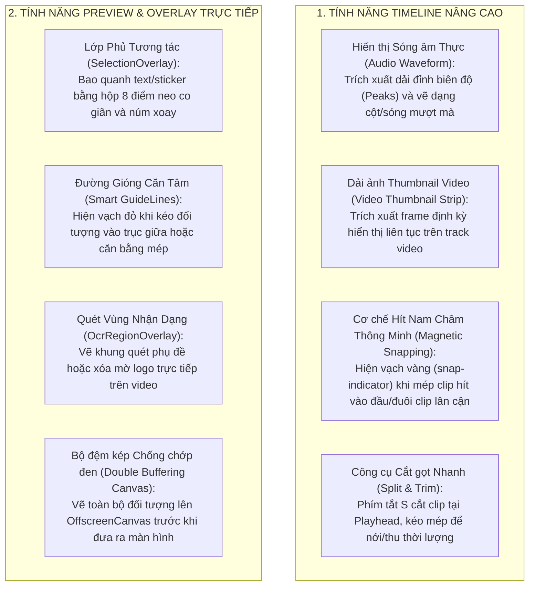

# KẾ HOẠCH CHI TIẾT: NÂNG CẤP CANVAS TIMELINE & LỚP TƯƠNG TÁC PREVIEW TRỰC TIẾP
> **Mã kế hoạch**: `PLAN-05`  
> **Nguồn tham khảo**: `lemyloi-dichvideos/apps/web/src/components/editor/panels/` (`timeline/`, `preview/`)  
> **Áp dụng cho**: `dubbing-video/frontend/src/features/timeline/` & `frontend/src/features/player/`

---

## 1. PHÂN TÍCH CHUYÊN SÂU NGUỒN THAM KHẢO

### 1.1. Những Điểm Tinh Hoa của Timeline & Preview trong `lemyloi-dichvideos`
Giao diện Timeline và Preview của nguồn tham khảo được thiết kế tương đương các phần mềm dựng phim thương mại (CapCut, Premiere Pro, DaVinci Resolve) với 5 tính năng cốt lõi:

#### Chi tiết Kỹ thuật 1: Cơ chế Hít Nam châm Thông minh (`snap-indicator.tsx`)
- Ngưỡng khoảng cách hít (Snap Threshold): `10px` trên màn hình (tương ứng với thời gian $\Delta t = \frac{10}{\text{zoom}}$ giây).
- Khi người dùng kéo mép một câu thoại (Trim) hoặc di chuyển một clip:
  - Hệ thống tính toán khoảng cách tới: `PlayheadTime`, `startTime` và `endTime` của tất cả các câu thoại lân cận.
  - Nếu khoảng cách $\le \text{Snap Threshold}$, tự động hút tọa độ về mốc đó và kích hoạt vạch chỉ dẫn màu vàng `SnapIndicator`.
  - Phím tắt `N` cho phép bật/tắt chế độ hít nam châm tức thời.

#### Chi tiết Kỹ thuật 2: Trích xuất Sóng âm Nhẹ nhàng (Audio Waveform)
- Nguồn tham khảo trích xuất dữ liệu sóng âm qua `AudioContext.decodeAudioData()`, sau đó nén thành mảng đỉnh `peaks` (chỉ gồm các giá trị cực đại min/max trên mỗi khối 256 mẫu).
- Mảng `peaks` được lưu cache, khi vẽ trên Timeline Canvas chỉ cần đọc mảng số nguyên đơn giản thay vì xử lý lại file audio, đảm bảo thời gian vẽ $< 2\text{ms}$.

#### Chi tiết Kỹ thuật 3: Lớp phủ Tương tác Trực tiếp (`selection-overlay.tsx` & `guide-lines.tsx`)
- Tách biệt lớp hiển thị video và lớp điều khiển tương tác (Direct Manipulation).
- Người dùng có thể click trực tiếp vào dòng chữ phụ đề hoặc khung xóa watermark trên màn hình video:
  - Hiển thị bounding box màu xanh dương bao quanh.
  - 8 núm điều khiển tại 4 góc và 4 cạnh để phóng to/thu nhỏ (Resize).
  - 1 núm xoay phía trên để xoay góc (Rotate).
  - Tự động hiển thị các đường gióng màu đỏ (`guide-lines.tsx`) khi đối tượng trùng với trục tọa độ tâm ngang ($X = 50\%$) hoặc tâm dọc ($Y = 50\%$).

---

## 2. THIẾT KẾ ÁP DỤNG CHO DUBBING-VIDEO

### 2.1. Nâng cấp `CanvasTimeline.tsx` của `dubbing-video`
Hiện tại, `CanvasTimeline.tsx` của `dubbing-video` đã có kiến trúc Dual-Layer 60 FPS rất vững chắc (tách riêng Base Canvas và Playhead Canvas). Các tính năng tiếp thu từ nguồn tham khảo sẽ được tích hợp vào Base Canvas:
1. **Track Âm thanh (Audio Waveform)**:
   - Backend cung cấp endpoint `GET /api/media/waveform?projectId=...` trả về mảng `peaks` dạng JSON nén hoặc nhị phân Float32.
   - Hàm `drawWaveform()` trong `canvasDraw.ts` sẽ đọc mảng peaks và vẽ các cột sóng âm màu xanh tím với hiệu ứng dìm biên độ (Ducking) trực quan.
2. **Cơ chế Hít Nam châm (Magnetic Snapping)**:
   - Khi người dùng kéo mép câu thoại (`isResizingLeft` hoặc `isResizingRight`), tính khoảng cách hít tới Playhead và các câu lân cận.
   - Vẽ đường thẳng đứng màu vàng cam đứt nét trên `PlayheadCanvas` khi kích hoạt snap.
3. **Phím tắt Biên tập Cắt clip (`S`)**:
   - Khi Playhead đang nằm trong phạm vi của 1 câu thoại và người dùng nhấn `S` (Split): tự động chia câu thoại thành 2 nửa tại vị trí Playhead, cập nhật vào `cueStore` kèm Undo/Redo.

### 2.2. Nâng cấp `VideoPlayer.tsx` với Direct Manipulation Overlay
- Thêm lớp phủ `InteractionOverlay.tsx` trong suốt đặt đè lên video.
- Tích hợp 2 chế độ tương tác:
  1. **Chế độ ROI Selection (ở Step 1)**: Cho phép vẽ vùng quét OCR phụ đề gốc hoặc vùng xóa logo (Delogo).
  2. **Chế độ Subtitle Styling (ở Step 3/4)**: Cho phép click chọn dòng phụ đề trên video để di chuyển vị trí hiển thị (kéo lên trên, xuống dưới) hoặc co giãn kích thước chữ trực tiếp bằng chuột.

---

## 3. PHÂN KỲ NHIỆM VỤ CHI TIẾT (TASK BREAKDOWN)

> [!IMPORTANT]
> Toàn bộ các task dưới đây chỉ thực hiện sau khi kế hoạch được phê duyệt. Không chỉnh sửa code trước.

- [ ] **Task 5.1: Xây dựng Cơ chế Trích xuất & Caching Waveform Peaks**
  - Backend: Thêm endpoint `GET /api/media/waveform` trích xuất 100 điểm mẫu/giây từ file audio bằng ffmpeg/numpy.
  - Frontend: Tạo `src/utils/waveformCache.ts` lưu trữ dữ liệu peaks trong bộ nhớ.
- [ ] **Task 5.2: Tích hợp Vẽ Sóng âm trên `CanvasTimeline.tsx`**
  - Cập nhật hàm vẽ track audio trong `canvasDraw.ts`: vẽ các vạch đối xứng qua trục giữa.
  - Đảm bảo Viewport Culling $O(\log N)$ chỉ vẽ sóng âm trong phạm vi nhìn thấy (`visibleTimeRange`).
- [ ] **Task 5.3: Triển khai Thuật toán Hít Nam châm (Magnetic Snapping)**
  - Viết `src/utils/snapping.ts`: tính toán điểm snap gần nhất trong bán kính 10px.
  - Vẽ vạch chỉ thị Snap Indicator trên tầng Canvas Playhead Overlay.
- [ ] **Task 5.4: Bổ sung Thao tác Cắt (`S`) và Gộp Câu (`M`) trên Timeline**
  - Đăng ký phím tắt `S` để cắt câu thoại đang chọn tại mốc `currentTime`.
  - Đăng ký phím tắt `M` để gộp 2 câu thoại liền kề.
- [ ] **Task 5.5: Xây dựng Lớp phủ Tương tác Trực tiếp trên `VideoPlayer.tsx`**
  - Tạo `src/features/player/InteractionOverlay.tsx` hỗ trợ kéo vị trí phụ đề và vẽ khung ROI.
  - Tích hợp Smart GuideLines khi kéo đối tượng vào tâm màn hình.

---

## 4. TIÊU CHÍ NGHIỆM THU (VERIFICATION GATES)

1. **Hiệu năng 60 FPS được bảo toàn**: Việc vẽ thêm Audio Waveform không làm thời gian render mỗi frame của Base Canvas vượt quá $12\text{ms}$.
2. **Độ chính xác của Snap**: Khi kéo mép câu thoại lại gần Playhead hoặc câu khác dưới 10px, mép tự động hít chính xác vào mốc mili-giây, không bị lệch hoặc chồng lấn thời gian.
3. **Phím tắt mượt mà**: Phím `S` cắt câu tức thời, phản hồi dưới 50ms và có thể Undo (`Ctrl+Z`) hoàn hảo.
4. **Vượt qua bộ 3 lệnh Frontend**: `npx tsc --noEmit`, `npm run lint`, `npm run build` PASS 100%.
