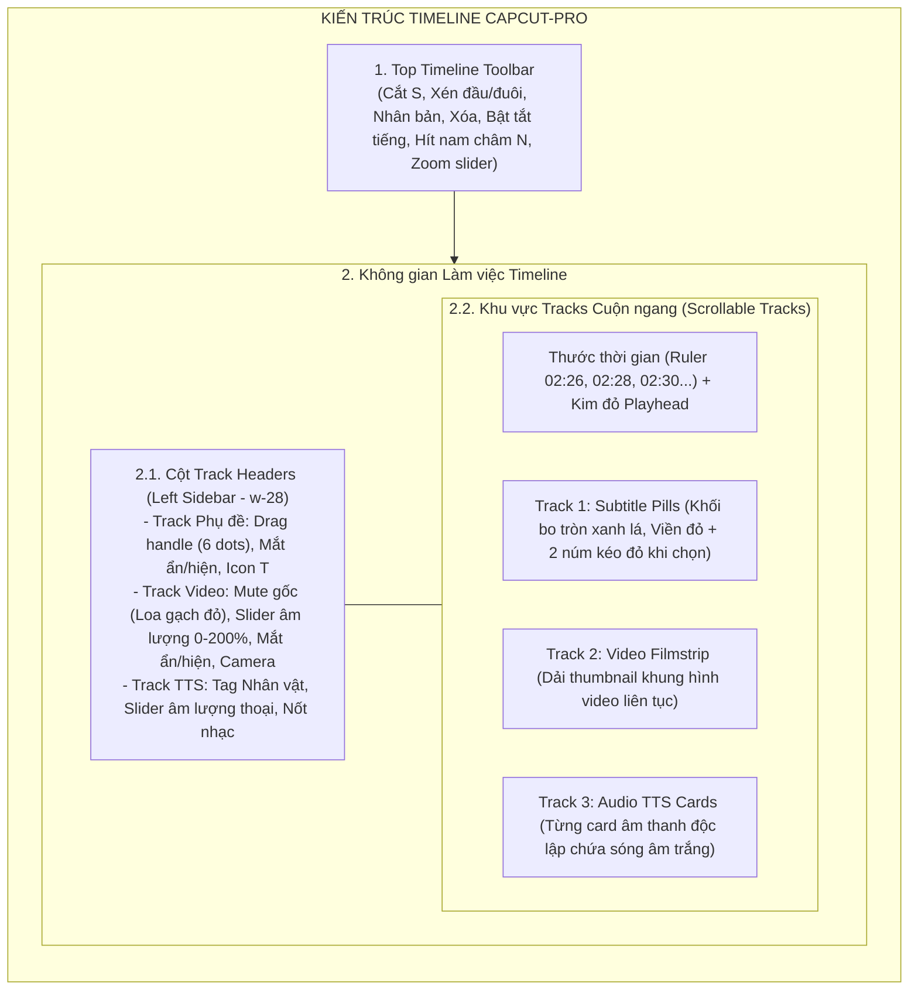

# KẾ HOẠCH NÂNG CẤP TIMELINE: TRẢI NGHIỆM BIÊN TẬP CAPCUT-PRO, KÉO THẢ, CẮT GHÉP & ĐIỀU TIẾT ÂM LƯỢNG TRACK
> **Mã kế hoạch**: `PLAN-06`  
> **Nguồn tham khảo trực tiếp**: `lemyloi-dichvideos/apps/web/src/components/editor/panels/timeline/`  
> **Dựa trên ảnh phân tích thực tế**: Ảnh giao diện Timeline người dùng cung cấp (`media_1795166165066_074b3e8f.jpg`)  
> **Áp dụng cho**: `dubbing-video/frontend/src/features/timeline/`, `src/features/player/`, `src/stores/timelineStore.ts`, `backend/server.py`

---

## 1. PHÂN TÍCH CHUYÊN SÂU TỪ ẢNH THỰC TẾ & MÃ NGUỒN `LEMYLOI-DICHVIDEOS`

Từ ảnh chụp thực tế của dự án tham khảo và việc bóc tách mã nguồn tại `lemyloi-dichvideos/apps/web/src/components/editor/panels/timeline/`, giao diện Timeline chuyên nghiệp đạt chuẩn CapCut / Premiere bao gồm 4 khối kiến trúc then chốt:



---

### 1.1. Chi tiết Kỹ thuật 1: Bật/Tắt tiếng & Điều chỉnh Âm lượng Video gốc (`TrackVolumeControl`)
Trong `volume-control.tsx` và `timeline-track.tsx` của nguồn tham khảo:
- **Nút Mute nhanh**: Click trực tiếp vào icon Loa ở đầu Track Video để tắt/bật âm thanh gốc của video. Khi tắt âm, icon chuyển sang màu đỏ với gạch chéo (`VolumeOffIcon`), tương ứng `videoRef.current.muted = true` hoặc âm lượng $= 0$.
- **Thanh trượt Âm lượng Track (Volume Popover / HoverCard)**:
  - Khi rê chuột (Hover) hoặc click vào icon loa, hiện một Popover nổi chứa thanh trượt từ `0%` đến `200%`.
  - Người dùng có thể chủ động **hạ âm lượng video gốc xuống 10% - 30%** để làm nhạc nền (BGM) nhẹ nhàng trước khi áp dụng AI Ducking, hoặc bấm nút **"Mặc định (100%)"** để hoàn tác nhanh.
  - Tích hợp 2 chiều: Khi lồng tiếng phát, thuật toán Audio Ducking sẽ tự động dìm âm thanh từ mức âm lượng track đang đặt xuống mức $-16.5\text{ dB}$, sau đó nhả về đúng mức âm lượng người dùng đã cấu hình.

---

### 1.2. Chi tiết Kỹ thuật 2: Kéo thả Khối câu Thoại (Direct Drag-and-Drop & Move Cue)
Trong `use-element-interaction.ts`:
- **Ngưỡng kích hoạt kéo (Drag Threshold)**: `DRAG_THRESHOLD_PX = 5px`.
  - Nhấp chuột đơn thuần $\le 5\text{px}$: Chọn câu thoại (`setSelectedCueId`), di chuyển Playhead đến vị trí nhấp.
  - Kéo chuột $> 5\text{px}$: Chuyển sang chế độ `isDragging = true` (`dragMode = 'move-cue'`).
- **Dời trục thời gian tự do**:
  - Khối câu thoại di chuyển linh hoạt dọc theo trục ngang $X$ tương ứng với $\Delta t = \frac{\Delta x}{\text{zoom}}$.
  - Mốc thời gian mới: $\text{newStartTime} = \text{startElementTime} + \Delta t$, $\text{newEndTime} = \text{newStartTime} + \text{duration}$.
- **Hít nam châm (Snapping)**: Khi mép đầu (`newStartTime`) hoặc mép đuôi (`newEndTime`) lại gần Playhead hoặc mép câu lân cận trong bán kính `10px`, tự động hút chính xác vào mốc đó và hiện vạch chỉ thị Snap màu vàng.
- **Thả chuột (MouseUp)**: Cập nhật thời gian vào `cueStore.updateCue()` kèm lưu vào lịch sử hoàn tác (Undo/Redo `MAX_HISTORY_STEPS = 50`).

---

### 1.3. Chi tiết Kỹ thuật 3: Tạo hình Khối câu được Chọn & Núm Co giãn Chuẩn CapCut (`ResizeHandle`)
Quan sát trực quan từ ảnh do người dùng cung cấp:
- **Khối câu bình thường**: Bo tròn mềm mại (`rounded-[0.5rem]`), màu xanh lá (`#22c55e` hoặc theo màu của từng Nhân vật / Speaker Role), chữ hiển thị cô đọng cắt ngắn (`Tôi biết nhiều th...`, `Đi bar,`, `đi leo núi.`).
- **Khối câu đang được chọn (Selected State)**:
  - Viền đỏ rực bao quanh toàn khối: `border-2 border-red-500 ring-2 ring-red-500/50 shadow-[0_0_10px_rgba(239,68,68,0.4)]`.
  - Hai núm co giãn ở đầu trái và đầu phải (`ResizeHandle`):
    - Khối nền màu đỏ: `bg-red-500 w-[0.65rem] border border-white/80 shadow-md`.
    - Đầu trái bo góc trái (`rounded-l-[0.35rem] cursor-w-resize`), đầu phải bo góc phải (`rounded-r-[0.35rem] cursor-e-resize`).
    - Lõi giữa là **vạch trắng dọc bo tròn**: `w-[0.2rem] h-[1.5rem] bg-white rounded-full`.
  - Khi rê chuột vào 2 núm này: Trỏ chuột đổi sang `ew-resize`, kéo chuột để nới hoặc thu ngắn câu thoại (`trim-start` / `trim-end`).

---

### 1.4. Chi tiết Kỹ thuật 4: Bộ Công cụ Cắt Ghép trên Top Toolbar
Thanh công cụ trên cùng được trang bị đầy đủ các phím chức năng dựng phim:
1. **Cắt câu (`S` / Scissors)**: Cắt khối câu thoại đang chọn tại đúng vị trí Playhead thành 2 nửa độc lập.
2. **Xén trái (`Q` / Trim Left)**: Xén bỏ đoạn đầu của câu tính từ mép trái đến Playhead.
3. **Xén phải (`W` / Trim Right)**: Xén bỏ đoạn cuối của câu tính từ Playhead đến mép phải.
4. **Ghép câu (`M` / Merge)**: Gộp câu đang chọn với câu liền kề thành 1 câu duy nhất.
5. **Nhân bản (`Ctrl+D` / Duplicate)**: Sao chép câu thoại sang khoảng trống kế tiếp.
6. **Xóa câu (`Delete` / `Backspace`)**: Xóa bỏ câu thoại đang chọn kèm lưu Undo/Redo.
7. **Bật/Tắt Hít Nam châm (`N` / Magnetic Snap)**: Chuyển đổi trạng thái tự hít điểm.
8. **Thanh trượt Zoom**: Thu nhỏ tới toàn cảnh video (`Fit`) hoặc phóng to chi tiết tới từng frame hình.

---

### 1.5. Chi tiết Kỹ thuật 5: Dải Filmstrip Video Thumbnails & Audio Waveform Cards
- **Track 2 (Video Filmstrip)**:
  - Thay vì để một dải màu phẳng, Timeline hiển thị dải các khung hình thu nhỏ (Thumbnails) của video chạy liên tục nối tiếp nhau.
  - Backend cung cấp endpoint trích xuất nhanh frame hoặc frontend trích xuất qua `OffscreenCanvas` / Video Element ngầm, nạp vào bộ nhớ đệm cache.
- **Track 3 (Audio TTS Cards)**:
  - Tách thành từng khối card âm thanh tương ứng chuẩn xác với từng câu phụ đề ở Track 1.
  - Mỗi card âm thanh có màu nền đồng bộ với nhân vật, bên trong vẽ các cột sóng âm (Audio Waveform Peaks) màu trắng tinh tế với đường kẻ tâm đứt đoạn.

---

## 2. KIẾN TRÚC THIẾT KẾ ÁP DỤNG CHO DUBBING-VIDEO

Để đáp ứng tối đa trải nghiệm CapCut-lite nhưng vẫn **bảo toàn hiệu năng 60 FPS**, hệ thống áp dụng mô hình kiến trúc **Hybrid UI & Dual-Layer Canvas**:

```
┌────────────────────────────────────────────────────────────────────────┐
│                        Top Timeline Toolbar                            │
│ [ Cắt S ] [ Xén Q/W ] [ Ghép M ] [ Xóa ]  |  [ 🧲 Hít N ] [ Zoom Slider ]│
├─────────────┬──────────────────────────────────────────────────────────┤
│ Track Header│                     Timeline Body                        │
│   Sidebar   │ ┌──────────────────────────────────────────────────────┐ │
│  (w-28 px)  │ │ Ruler: 02:26      02:28      02:30      02:32      02:34 │ │
│             │ └──────────────────────────────────────────────────────┘ │
│ [::] 👁 T   │  [ Tôi biết nhiều th... ]  [ Đi bar, ] [|| đọc sá ||]  [leo..]│
│             │                                        (Selected Red)    │
│ [::] 🔇 👁 📹│  [Frame 1][Frame 2][Frame 3][Frame 4][Frame 5][Frame 6]   │
│ (Mute/Vol)  │  (Continuous Video Thumbnail Filmstrip Strip)            │
│             │                                                          │
│ [::] 👤 🔊 🎵│  [  |||||||||||||  ]   [  ||||||||  ] [  |||||||||  ]   │
│             │  (Individual TTS Audio Waveform Cards)                   │
└─────────────┴──────────────────────────────────────────────────────────┘
```

### 2.1. Nâng cấp Store Quản lý (`timelineStore.ts`)
Bổ sung các thuộc tính và action cho từng track:
```typescript
interface TrackConfig {
  id: 'cues' | 'video' | 'tts-audio';
  name: string;
  height: number;
  visible: boolean;
  locked: boolean;
  muted: boolean;       // Bật / tắt tiếng track
  volume: number;      // 0.0 đến 2.0 (mặc định 1.0)
}
```
- Khi `tracks.find(t => t.id === 'video').muted === true`: Tự động tắt tiếng Video gốc trong `VideoPlayer.tsx`.
- Khi `tracks.find(t => t.id === 'video').volume !== 1.0`: Scale âm lượng video gốc tương ứng.

### 2.2. Xử lý Kéo thả Cả Khối (`move-cue`) trong `CanvasTimeline.tsx`
Mở rộng state tương tác:
```typescript
type DragMode = 'scrub' | 'resize-start' | 'resize-end' | 'move-cue' | null;
```
- Khi người dùng click vào vùng giữa của khối câu (cách mép $> 8\text{px}$) và di chuyển chuột:
  - Nếu khoảng cách dịch chuyển $> 5\text{px}$: kích hoạt `dragMode = 'move-cue'`.
  - Tính toán $\Delta t = \frac{\Delta x}{\text{zoom}}$.
  - Tính vị trí mới: $\text{targetStart} = \text{initialStart} + \Delta t$.
  - Áp dụng `calculateMagneticSnap` để hít vào Playhead hoặc mép các câu lân cận.
  - Thả chuột: Ghi nhận sự thay đổi vào `cueStore.updateCue()` kèm Undo/Redo.

---

## 3. PHÂN KỲ KẾ HOẠCH CHI TIẾT (TASK BREAKDOWN)

> [!IMPORTANT]
> Toàn bộ các công việc dưới đây tuân thủ quy tắc: **Không viết code trước khi kế hoạch được rà soát và phê duyệt**. Mỗi task sẽ được kiểm thử độc lập trước khi chuyển sang task kế tiếp.

### Giai đoạn 1: Điều khiển Âm lượng & Bật/Tắt tiếng Track (Mute & Volume Control)
- [ ] **Task 6.1**: Cập nhật `TrackConfig` trong `src/types/index.ts` và `timelineStore.ts`:
  - Thêm thuộc tính `muted: boolean` và `volume: number` (mặc định: `muted = false`, `volume = 1.0`).
  - Viết các action: `setTrackMute(trackId, muted)` và `setTrackVolume(trackId, volume)`.
- [ ] **Task 6.2**: Tạo Component Cột Tiêu đề Track (Left Track Header Sidebar - `TrackHeaderSidebar.tsx`):
  - Hiển thị danh sách 3 Track (`Subtitles`, `Video`, `AI Narration`).
  - Nút Mute nhanh (Loa gạch chéo đỏ khi tắt).
  - Popover thanh trượt điều chỉnh âm lượng từ `0%` đến `200%` kèm nút "Mặc định (100%)".
  - Nút Ẩn/Hiện track (Icon Mắt).
- [ ] **Task 6.3**: Kết nối Điều khiển Âm lượng vào `VideoPlayer.tsx`:
  - Đồng bộ trạng thái `muted` và `volume` của Video Track vào thẻ `<video>`.
  - Kết hợp hài hòa với thuật toán Audio Ducking (dìm âm lượng từ mức volume đã cài đặt xuống $-16.5\text{ dB}$ và hồi lại mượt mà).

### Giai đoạn 2: Tương tác Kéo thả Khối câu Thoại (Direct Drag & Drop Move Cue)
- [ ] **Task 6.4**: Mở rộng Logic Tương tác trong `CanvasTimeline.tsx`:
  - Thêm nhận diện `dragMode = 'move-cue'` với ngưỡng kích hoạt `5px`.
  - Cho phép người dùng nhấp vào thân câu thoại và rê chuột để dời mốc thời gian dọc theo trục thời gian.
  - Tích hợp tự động Hít nam châm (Magnetic Snapping) trong quá trình kéo khối câu.
  - Khi thả chuột: Lưu mốc thời gian mới vào `cueStore` hỗ trợ hoàn tác Undo (`Ctrl+Z`).

### Giai đoạn 3: Tái thiết kế Giao diện Khối câu Chuẩn CapCut (Selected Box & Red Handles)
- [ ] **Task 6.5**: Thiết kế Núm Co giãn & Viền Đỏ Nổi bật (`ResizeHandle` & Selected Styling):
  - Tạo kiểu viền đỏ phát sáng cho khối câu đang chọn: `border-2 border-red-500 ring-2 ring-red-500/50 shadow-[0_0_10px_rgba(239,68,68,0.4)]`.
  - Hai núm kéo đỏ bo góc ở 2 đầu: `w-[0.65rem] bg-red-500 rounded-l/r-[0.35rem]` với vạch trắng dọc `h-[1.5rem] w-[0.2rem] bg-white`.
  - Tạo hình khối câu dạng Pill bo tròn mềm mại màu xanh lá / màu theo nhân vật (`SpeakerRole`).

### Giai đoạn 4: Bộ Công cụ Cắt Ghép trên Top Toolbar
- [ ] **Task 6.6**: Hoàn thiện các công cụ trên `TimelineToolbar.tsx`:
  - Nút Cắt câu tại Playhead (Phím `S` / Scissors).
  - Nút Xén đầu trái câu (Trim Left / `Q`) và Xén đuôi phải câu (Trim Right / `W`).
  - Nút Ghép câu (Merge / `M`).
  - Nút Nhân bản câu (`Ctrl+D` / Duplicate).
  - Nút Xóa câu (`Delete` / Backspace).

### Giai đoạn 5: Hiển thị Dải Filmstrip Video & Card Sóng âm Thoại
- [ ] **Task 6.7**: Tích hợp Dải Thumbnail Video Filmstrip:
  - Trích xuất frame định kỳ hiển thị liên tục trên Track Video.
  - Bộ đệm cache tránh giật lag khi cuộn timeline.
- [ ] **Task 6.8**: Tách Card Sóng âm AI Narration độc lập theo từng câu:
  - Hiển thị khối card âm thanh ngay dưới câu thoại tương ứng.
  - Vẽ sóng âm màu trắng đối xứng qua trục tâm đứt đoạn.

---

## 4. TIÊU CHÍ NGHIỆM THU (VERIFICATION GATES)

1. **Thao tác Âm lượng Mượt mà**: Click nút Loa lập tức tắt tiếng video gốc; kéo slider âm lượng từ 0% đến 200% phản hồi tức thì và không gây chớp giật video.
2. **Kéo thả Khối câu Trực quan**: Nhấp giữ thân câu kéo sang trái/phải dời thời gian mượt mà 60 FPS, tự hít vào điểm lân cận dưới 10px, hoàn tác (`Ctrl+Z`) chính xác.
3. **Thao tác Cắt/Ghép Chuẩn xác**: Phím `S` cắt đôi câu tại Playhead, phím `M` ghép 2 câu liền kề thành 1 câu duy nhất kèm gộp văn bản phụ đề và audio.
4. **Tạo hình Chuẩn CapCut**: Câu đang chọn có viền đỏ phát sáng và 2 núm kéo đỏ vạch trắng đặc trưng như ảnh tham khảo.
5. **Kiểm tra Mã nguồn**: Vượt qua bộ 3 lệnh kiểm tra Frontend (`npx tsc --noEmit`, `npm run lint`, `npm run build`) và bộ test Backend (`pytest backend/test_backend.py`).
